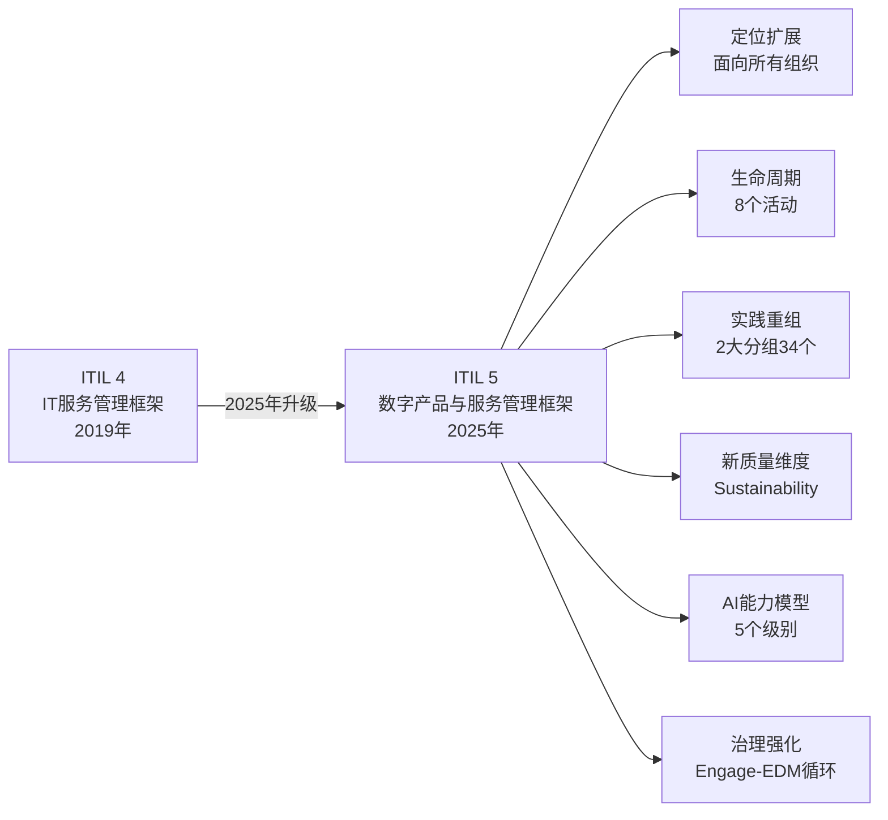
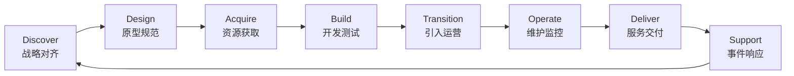

# ITIL 5 初级备考知识点大全

> **适用版本**：ITIL Foundation (Version 5.0, February 2025)  
> **发布机构**：PeopleCert International Limited  
> **考试形式**：40道单选题，60分钟，26题及以上通过  
> **本文聚焦**：ITIL 5相对ITIL 4的核心变化，结合官方书籍、课件与官方样题，梳理200个高频考点  
> **难度标注**：★基础 ★★中等 ★★★易混淆

---

## ITIL 5 vs ITIL 4 核心变化速览

| 对比维度 | ITIL 4 | ITIL 5 |
|---------|--------|--------|
| **框架定位** | IT服务管理 | 数字产品与服务管理（面向所有组织） |
| **框架名称** | Service Value System (SVS) | ITIL Value System (ITIL VS) |
| **实践分组** | 三组（通用14/服务管理17/技术3） | 两组（通用管理12/产品与服务管理22） |
| **价值链活动** | 六个（含Engage、Improve） | 八个（Discover/Design/Acquire/Build/Transition/Operate/Deliver/Support） |
| **服务质量指标** | Utility+Warranty+Experience | Utility+Warranty+**Sustainability**+Experience |
| **AI整合** | 原则性提及 | 明确引入AI能力模型（5级） |
| **设计方法** | Design Thinking | Human-Centred Design (HCD) |
| **核心产出** | 服务（Service） | 数字产品 + 数字服务 |
| **价值流分类** | 通用价值流 | 核心价值流 + 支持性价值流 |
| **数据/知识层级** | 数据→信息 | 数据→信息→知识（三层明确区分） |

---

## 第一部分：ITIL 5 背景与整体框架（Q1–Q20）★

**Q1：ITIL 5（ITIL Foundation Version 5.0）的发布时间、发布机构和核心定位是什么？**

A1：ITIL 5（ITIL Foundation Version 5.0）于**2025年2月**由**PeopleCert International Limited**正式发布。其核心定位是：**面向所有希望通过数字产品与数字服务创造价值的组织与个人**，不再局限于IT部门。相比ITIL 4（2019年发布，专注于IT服务管理数字化转型），ITIL 5将适用对象从"IT部门"正式扩展为"全组织数字化运营体系"，从方法框架升级为数字时代的"组织运行蓝图"。

---

**Q2：ITIL 4的SVS与ITIL 5的ITIL VS有何核心区别？名称变化背后的深层含义是什么？**

A2：ITIL 4称"**Service Value System（服务价值系统/SVS）**"，以服务为中心；ITIL 5改称"**ITIL Value System（ITIL VS）**"，去掉"Service"前缀。这一变化的深层含义是：ITIL 5将价值创造的载体从"服务"扩展到"数字产品+数字服务"，强调组织不仅管理服务，也管理数字产品的全生命周期。ITIL VS的目的是确保组织通过数字产品与服务的使用与管理，持续、可持续地与所有利益相关者共创价值。

---

**Q3：ITIL Value System（ITIL VS）由哪五个核心要素组成？各要素的作用是什么？**

A3：ITIL VS由以下五个核心要素构成：①**指导原则（Guiding Principles）**：七条跨场景通用原则，指导所有决策；②**治理（Governance）**：通过Engage→Evaluate→Direct→Monitor循环确保合规与方向；③**价值链（Value Chain）**：八个生命周期管理活动，构成组织的核心行动框架；④**管理实践（Management Practices）**：34个赋能价值链活动的实践能力模块；⑤**持续改进（Continual Improvement）**：七步改进模型，驱动价值系统持续演进。五要素灵活组合，将机会与需求转化为价值。

---

**Q4：ITIL VS的输入和输出分别是什么？ITIL 5如何定义"价值（Value）"？**

A4：ITIL VS的**关键输入**是**机会（Opportunity）**和**需求（Demand）**；最终**产出**是**价值（Value）**。ITIL 5中价值的定义为：**"某事物被感知到的收益、有用性和重要性（The perceived benefits, usefulness, and importance of something）"**。价值是主观的，受服务体验影响，随时间和情境变化。组织的所有活动都应直接或间接地链接回对自身、客户及其他利益相关者的价值创造。

---

**Q5："组织目的（Purpose）"、"运行模型（Operating Model）"和"价值链（Value Chain）"三者的关系是什么？**

A5：三者层层递进，构成价值创造的完整链条：①**组织目的（Purpose）**：定义"组织为其消费者和其他利益相关者做什么以及为什么做"，即Why；②**运行模型（Operating Model）**："一种概念性和/或可视化的表示，展示组织如何与客户共创价值，以及如何自我运营"，即How；③**价值链（Value Chain）**："通过提供产品或服务而实现价值的全套活动"，即What。三者关系：目的→运行模型→价值链，从"为何存在"→"如何运作"→"做什么"，层层具化。

---

**Q6：ITIL 5的实践体系如何重构？与ITIL 4相比，实践数量和分组有何不同？**

A6：**ITIL 4**：34个实践分为三组——通用管理实践14个、服务管理实践17个、技术管理实践3个。**ITIL 5**：34个实践重构为两组——①**通用管理实践（General Management Practices）**：12个；②**产品与服务管理实践（Product and Service Management Practices）**：22个。关键变化：ITIL 4通用管理实践中的**信息安全管理**和**服务财务管理**被移入ITIL 5的产品与服务管理实践组，强调其对产品和服务价值实现的直接支撑作用。总数仍为34个，但分组逻辑从三分法变为两分法。

---

**Q7：ITIL 5中12个通用管理实践（General Management Practices）包括哪些？**

A7：ITIL 5的12个通用管理实践包括：①架构管理（Architecture Management）；②持续改进（Continual Improvement）；③知识管理（Knowledge Management）；④测量与报告（Measurement and Reporting）；⑤组织变更管理（Organizational Change Management）；⑥项目管理（Project Management）；⑦组合管理（Portfolio Management）；⑧关系管理（Relationship Management）；⑨风险管理（Risk Management）；⑩战略管理（Strategy Management）；⑪供应商管理（Supplier Management）；⑫劳动力与人才管理（Workforce and Talent Management）。记忆口诀：架持知测组项，组关风战供劳。

---

**Q8：管理实践（Management Practice）在ITIL 5中的定义是什么？实践与价值链活动的关系是什么？**

A8：**管理实践定义**："**一组为执行工作或实现目标而设计和采用的组织资源与能力（A set of organizational resources and capabilities designed and adopted for performing work or accomplishing an objective）**"。管理实践与价值链的关系：实践**赋能并支持（enable and support）**价值链活动。每个生命周期活动（如Discover、Build等）都需要特定管理实践提供能力支撑。改进一个管理实践通常会对多个价值流产生积极影响。实践是"能力工具箱"，价值链活动是"使用这些工具的框架"。

---

**Q9：ITIL 5官方实践指南（Official Practice Guide）的标准章节结构包括哪几个部分？**

A9：每个ITIL 5官方实践指南包含六个标准章节：①**通用信息（General Information）**：目的、关键术语、范围、实践成功因素、关键指标；②**组织与人员（Organizations and People）**：角色、职责、能力要求与组织架构；③**信息与技术（Information and Technology）**：数据管理、技术工具需求；④**合作伙伴与供应商（Partners and Suppliers）**：第三方依赖与外部支持；⑤**价值流与流程（Value Streams and Processes）**：实践赋能的具体工作流；⑥**能力评估与发展（Capability Assessment and Development）**：成熟度描述与自评框架（基于ITIL成熟度模型）。

---

**Q10：ITIL 5的四个维度（Four Dimensions）是什么？与ITIL 4相比有何新增内容？**

A10：四个维度：①**组织与人员（Organizations and People）**——文化、领导力、技能、结构；②**信息与技术（Information and Technology）**——数据、信息、知识及AI工具；③**合作伙伴与供应商（Partners and Suppliers）**——外部关系与协议；④**价值流与流程（Value Streams and Processes）**——内外部工作流。ITIL 5相比ITIL 4的新增内容：在第二维度"信息与技术"中正式引入**ITIL AI能力模型（AI Capability Model，5个能力级别）**；明确区分**数据（Data）、信息（Information）和知识（Knowledge）**三个层次；增加了组织与人员维度中对**AI与组织（Organizations, People and AI）**的专项讨论。

---

**Q11："组织与人员"维度在ITIL 5中强调哪些关键内容？领导力的核心行为有哪些？**

A11："组织与人员"维度强调：**心理安全（Psychological Safety）文化**和**持续学习环境**。ITIL 5中领导力的核心行为包括：①激励并鼓励员工（Engage and inspire people）；②以诚信行事赢得尊重（Behave with integrity to generate respect）；③关注价值（Focus on value）；④保持战略对齐与愿景清晰（Stay aligned with the overall vision）；⑤赋权员工（Empower employees）。该维度还强调：组织的角色、职责和授权体系须清晰定义，以支撑整体战略和运行模型。心理安全和持续学习是"组织与人员"维度受领导力直接影响的关键领域。

---

**Q12：ITIL AI能力模型（ITIL AI Capability Model）有哪五个级别？**

A12：ITIL 5正式引入的**AI能力模型**将组织AI能力分为五个递进级别：①**AI意识（AI Awareness）**：了解AI基本概念和潜力；②**AI采用（AI Adoption）**：将AI工具引入特定流程；③**AI整合（AI Integration）**：AI与现有工作流系统化融合；④**AI优化（AI Optimization）**：持续优化AI应用，提升效率与质量；⑤**AI转型（AI Transformation）**：AI成为组织运营和价值创造的核心驱动力。该模型帮助组织评估当前AI能力水平、识别差距并规划提升路径，体现了ITIL 5对AI能力体系化发展的重视。

ITIL 5 官方教材中提出的是 **6C AI能力模型**（6C AI Capability Model），包含六种能力维度，而非五个递进级别：

| 官方6C            | 中文     | 含义                                                         |
| :---------------- | :------- | :----------------------------------------------------------- |
| **Creation**      | 生成     | AI根据提示/触发器生成新内容（文案、代码、文档等）            |
| **Curation**      | 整理     | AI识别冗余/过时/不一致信息，改善数据质量与组织结构           |
| **Clarification** | 阐释澄清 | AI 通过总结、改写、重组或翻译，简化复杂信息，帮助用户理解定位内容 |
| **Cognition**     | 认知     | AI识别数据中的模式、异常或隐藏洞察，实现主动检测与预测       |
| **Communication** | 沟通     | AI作为沟通界面，帮助用户自然地与服务和系统互动               |
| **Coordination**  | 协调     | AI自主在系统间执行、协调或触发操作                           |

---

**Q13："信息与技术"维度中，ITIL 5如何区分数据、信息和知识三者？**

A13：ITIL 5明确区分了三者的层次关系：①**数据（Data）**：原始的、未经处理的事实和数字，是信息的基础；②**信息（Information）**：经过处理、组织化的数据，具有上下文意义，能够回答"是什么"（What）；③**知识（Knowledge）**：对信息的深度理解和经验积累，能够支持决策，回答"如何做"（How）。三者关系：数据→信息→知识，层层递进，知识是组织最有价值的无形资产。ITIL 5特别强调：组织需确保能够从技术和数据中真正获取价值，而不仅仅是收集数据。

---

**Q14："合作伙伴与供应商"维度在ITIL 5中涵盖哪些内容？与ITIL 4的SIAM相比有何变化？**

A14："合作伙伴与供应商"维度涵盖组织与其他参与**产品发现、设计、构建、转换、运营、交付、支持及持续改进**的外部组织之间的关系，以及相关合同和协议。与ITIL 4相比：ITIL 4曾单独提及**SIAM（服务集成与管理/Service Integration and Management）**；ITIL 5则明确指出已将SIAM纳入更广泛的合作伙伴管理视角，不再作为独立主题单独强调。这反映了ITIL 5更加强调生态化协作，而非单一供应商管理框架。

---

**Q15："价值流与流程"维度如何在ITIL 5中处理工作流复杂性？四种复杂性类型分别是什么？**

A15：ITIL 5在"价值流与流程"维度中新增**复杂性语境（Complexity Context）**分析，将工作情境分为四类：①**明显（Obvious）**：因果关系清晰，最佳实践适用，可直接套用标准做法；②**繁杂（Complicated）**：需要专家分析，有正确答案但需要专业知识才能找到；③**复杂（Complex）**：因果关系只能事后回顾，需要试验性探索（Probe-Sense-Respond）；④**混沌（Chaotic）**：无因果关系可循，需先采取行动稳定局面（Act-Sense-Respond）。这四类指导组织在不同场景选择合适的流程设计和响应策略，避免一刀切。

关联**Cynefin 框架（Cynefin Framework）** ，也常译作**库尼芬模型**。

它是由威尔士学者**戴维・斯诺登（Dave Snowden）\**于 1999 年提出的\**决策与问题分析框架**，核心是将问题 / 情境分为**五个域**，指导不同场景下的决策方式。

###### 一、五个核心领域（决策情境）

1. **简单域（Clear）—— 已知的已知**

   

   - 特征：因果关系**显而易见、直接明确**
   - 策略：**感知 → 分类 → 响应**
   - 方法：套用**最佳实践、标准流程、规则**
   - 风险：**自满→ complacency**，容易变成 “复杂”

   

2. **繁杂域（Complicated）—— 已知的未知**

   

   - 特征：因果存在，但**需要分析、专家判断、调查**才能理清
   - 策略：**感知 → 分析 → 响应**
   - 方法：**专家诊断、多方案分析、事实驱动**
   - 例子：工程故障排查、复杂项目规划

   

3. **复杂域（Complex）—— 未知的未知**

   

   - 特征：**因果只能事后看清**，充满不确定性、涌现性
   - 策略：**探针 → 感知 → 响应**（先小试、观察、再调整）
   - 方法：**实验、迭代、敏捷、试错、涌现模式**
   - 例子：创新、市场、战略、组织变革

   

4. **混乱域（Chaotic）—— 不可知**

   

   - 特征：**因果完全不明、危机、失控**
   - 策略：**行动 → 感知 → 响应**（先控制、止血、建立秩序）
   - 方法：**果断指令、快速行动、权威决策、危机管理**
   - 例子：突发事故、紧急危机、崩盘

   

5. **无序域（Disorder）**

   

   - 特征：**分不清属于哪一类**，一团乱、无共识
   - 策略：**拆解 → 分类到前四域 → 分别处理**

   

###### 二、核心逻辑（一句话记）

- **简单：照章办事**
- **繁杂：专家分析**
- **复杂：试点迭代**
- **混乱：强力控制**
- **无序：拆分归类**

### 三、常见用途

- 项目管理、战略决策、风险管理
- 问题诊断、危机处理、组织变革
- 敏捷 / 精益 / 创新管理

---

**Q16：ITIL 5产品与服务生命周期模型包含哪八个活动？各活动的核心目的是什么？**

A16：八个生命周期活动及目的：①**Discover（发现）**：确保产品路线图与消费者需求和组织战略持续对齐；②**Design（设计）**：为产品与服务创建原型和规范；③**Acquire（获取）**：高效获取构建产品所需的必要资源；④**Build（构建）**：开发、集成并测试数字产品；⑤**Transition（转换）**：将新产品或更新产品无缝引入运营环境；⑥**Operate（运营）**：维护和监控数字产品，确保最优性能和可靠性；⑦**Deliver（交付）**：向用户提供服务，管理用户入驻/离场，收集反馈；⑧**Support（支持）**：识别并解决事件，履行灾难恢复程序，获取消费者反馈。

---

**Q17：ITIL 5中"改进（Improve）"活动为何从价值链活动中独立出来？改进如何体现在整体框架中？**

A17：ITIL 4将"Improve"作为服务价值链的六个活动之一。ITIL 5将其**从生命周期活动中独立出来，并入ITIL持续改进模型（Continual Improvement Model）**，成为治理之下的长期机制。原因：改进不应只是某个阶段的动作，而应是贯穿整个价值系统、始终运行的闭环机制；将改进提升为独立的持续机制，体现了"改进是治理驱动的组织能力，而非一次性活动"的理念。在ITIL 5框架中，持续改进是ITIL VS五要素之一，与治理并列，驱动整个系统的持续演进。

---

**Q18：ITIL 5中"Engage（参与）"活动为何不出现在生命周期八个活动中？它被整合到哪里了？**

A18：ITIL 4的服务价值链将"Engage"列为六个活动之一，但实践中常被误解为仅在特定阶段发生。ITIL 5将Engage概念整合进两个地方：①**治理活动的Engage环节**：治理主体需要持续与利益相关者互动，澄清需求、承诺和问责；②**服务旅程（Service Journey）**的整个过程中：服务提供者与消费者在每个接触点都在"参与"。通过这种方式，ITIL 5使"参与"从孤立活动变为贯穿全生命周期的持续行为，更准确地反映了现代数字服务关系的本质。

---

**Q19："Discover（发现）"活动的关键成功指标有哪些？为什么SLA绩效不是Discover的指标？**

A19：Discover活动的**关键成功指标**：①产品与服务产品组合的**战略契合度（Strategic fit）**；②产品与服务产品组合的**市场相关性（Market relevance）**；③利益相关者对产品与服务产品组合的**满意度（Stakeholder satisfaction）**；④**产品的商业成功（Commercial success，如适用）**。**SLA绩效不是Discover的指标的原因**：SLA（服务级别协议）绩效属于**Deliver（交付）**活动的成功指标，衡量的是已交付服务的质量；而Discover关注的是产品战略方向的正确性和市场对齐，两者处于生命周期的不同阶段。

---

**Q20：治理活动的四个组成部分是什么？ITIL 5治理与ITIL 4治理有何不同？**

A20：ITIL 5中治理活动由四个部分构成：①**Engage（参与）**：治理主体与利益相关者互动，澄清需求、承诺和责任；②**Evaluate（评估）**：评估组织当前状态、战略、组合、政策和关系等；③**Direct（指导）**：根据评估结果建立或修订政策与战略；④**Monitor（监控）**：监控绩效和合规情况，确保战略对齐。与ITIL 4相比，ITIL 5在治理中**新增了Engage环节**，形成Engage→Evaluate→Direct→Monitor的完整循环，强调治理主体需主动与利益相关者持续互动，而非仅在问题发生时介入。

---

## 第二部分：数字产品与服务核心概念（Q21–Q50）★★

**Q21：ITIL 5中"数字产品（Digital Product）"的定义是什么？与ITIL 4的"产品"定义有何区别？**

A21：**数字产品（Digital Product）**定义："**基于数字技术的组织资源的组合，旨在向消费者提供价值（A combination of an organization's resources based on digital technology and designed to offer value to consumers）**"。与ITIL 4的区别：ITIL 4的"产品（Product）"定义为"组织资源的配置，旨在向消费者提供价值"，未特别强调数字技术属性。ITIL 5通过引入"数字产品"，明确将现代价值载体聚焦于基于数字技术构建的资源组合，体现了数字时代服务管理的技术驱动特征。

---

**Q22：ITIL 5中"数字服务（Digital Service）"的定义是什么？数字服务与数字产品的关系是什么？**

A22：**数字服务（Digital Service）**定义："**完全或主要依赖数字产品而交付的服务（A service that fully or largely relies on digital products）**"。两者关系：**数字服务总是基于数字产品（Digital services are always based on digital products）**；数字产品提供能力（capabilities），服务产品组合（Service Offerings）描述这些能力为客户带来的潜在价值。数字产品是数字服务的基础，数字服务是通过数字产品向消费者提供价值的具体方式。注意：数字服务不能独立于数字产品而存在。

---

**Q23：ITIL 5中"服务（Service）"的定义是什么？服务如何实现价值共创？**

A23：**服务（Service）**定义："**一种通过促进消费者希望实现的结果来实现价值共创的手段，消费者无需自行管理特定的成本和风险（A means of enabling value co-creation by facilitating outcomes that consumers want to achieve, without the consumer having to manage specific costs and risks）**"。服务实现价值共创的方式：①帮助消费者达成预期结果；②将相关成本和风险的管理负担从消费者转移给服务提供者；③通过服务关系中的互动，双方共同创造彼此认可的价值。

---

**Q24：ITIL 5相对ITIL 4在服务质量维度上新增了哪一项？四个维度各自的含义是什么？**

A24：ITIL 5新增**Sustainability（可持续性）**，使服务质量维度从三个扩展为四个：①**Utility（效用）**：服务的功能性，"服务能做什么"，判断是否"适合目的（Fit for Purpose）"；②**Warranty（保证）**：服务的保障性，"服务如何执行"，判断是否"适合使用（Fit for Use）"，覆盖可用性、容量、安全性和连续性；③**Experience（体验）**：用户与服务及服务提供者互动的功能性与情感性感知总和（UX）；④**Sustainability（可持续性）**：服务满足并将持续满足**环境管理、社会进步和经济增长要求**的保障，体现ESG理念。

---

**Q25："可持续性（Sustainability）"在ITIL 5服务质量中的具体要求包括哪些内容？**

A25：ITIL 5中**Sustainability（可持续性）**定义："**对产品或服务满足并将持续满足环境管理、社会进步和经济增长要求的保障（The assurance that a product or service meets and will continue to meet the requirements for environmental stewardship, social progress, and economic growth）**"。可持续性要求具体包括：①**负责任的材料和组件采购**；②**负责任的劳动和就业实践**；③**使用清洁能源**；④**低碳足迹**；⑤**采用可回收材料**；⑥**透明供应链**。这些要求可能来自国家和国际法规标准，也可能来自组织自身的可持续发展战略。

---

**Q26：ITIL 5中"服务供给（Service Offering）"的定义是什么？它与数字产品、数字服务的关系是什么？**

A26：**服务供给（Service Offering）**定义："**一种或多种服务的正式描述，旨在满足目标消费者群体的需求（A formal description of one or more services designed to address the needs of a target consumer group）**"。服务供给通常包括：**商品（Goods）**（转移给消费者的有形物品）、**资源访问（Access to Resources）**（根据约定条款使用服务提供者资源）和**服务行为（Service Actions）**（提供者或双方共同执行的行动）。关系：数字产品提供能力基础→服务供给描述这些能力的价值主张→数字服务是实际交付方式。

---

**Q27：ITIL 5中三种服务交互形式（Service Interactions）是什么？各自的例子是什么？**

A27：ITIL 5中三种服务交互形式：①**商品转移（Transfer of Goods）**：服务提供者将商品转移给消费者，例如设备交付、耗材提供。在数字服务中较为少见；②**资源访问（Access to Resources）**：消费者根据约定条款访问并使用服务提供者的资源，例如获得文件共享平台的使用权限、云服务订阅；③**服务行为（Service Actions）**：由服务提供者或双方共同执行的行动，例如IT工程师协助用户配置笔记本电脑、用户培训、技术咨询。这三种形式可以在同一个服务场景中同时存在（如打印机交付+后续维护支持）。

---

**Q28：ITIL 5中"结果（Outcome）"和"输出（Output）"有何区别？服务对结果的影响方式有哪些？**

A28：**输出（Output）**是活动产生的有形或可见的交付物（如代码、报告、功能）；**结果（Outcome）**是对利益相关者产生的影响或变化，通常是无形的（如业务效率提升、满意度提高）。服务对结果的影响方式：①**支持实现预期结果**；②**同时可能阻碍或减少其他预期结果**；③**产生意想不到的结果，包括正面和负面**。因此，服务不能**保证**所有预期结果都会实现，且可能带来意外效果——这是ITIL 5考试的高频考点（官方样题Q4）。

---

**Q29：ITIL 5中"风险（Risk）"的定义是什么？服务对消费者风险的处理方式有哪些？**

A29：**风险（Risk）**定义："**可能导致损害或损失，或使实现目标更加困难的事件（A possible event that could cause harm or loss or make it more difficult to achieve objectives）**"。这是ITIL 5相对ITIL 4的明确化定义。服务对消费者风险的处理方式：①**完全消除**消费者的某些风险；②**减少**消费者的风险（更常见的情况）；③**引入新的风险**（如数据安全风险、供应商依赖风险）。消费者需评估风险的减少程度是否足以支撑价值主张。服务的价值感知受风险因素直接影响。

---

**Q30：ITIL 5中三种服务关系类型（Service Relationship Types）是什么？各自的典型聚焦点是什么？**

A30：ITIL 5中三种服务关系类型及其典型聚焦点：①**基础关系（Basic Relationship）**：聚焦于**支持与效率（Support and Efficiency）**，以标准化服务为主，强调SLA合规和服务台支持；②**合作关系（Cooperative Relationship）**：聚焦于**改进与效果（Improvement and Effectiveness）**，双方协作优化服务过程和结果；③**协同关系（Collaborative Relationship，也称Partner Relationship）**：聚焦于**创新与增长（Innovation and Growth）**，服务提供者与消费者深度融合、联合创新。三种关系代表服务关系的不同成熟度，并非一种优于另一种，组织需根据实际情境选择合适类型。

---

**Q31：ITIL 5中"服务旅程（Service Journey）"的定义是什么？它包含哪些关键阶段？**

A31：服务旅程包含七个阶段（官方描述为"stepping stones"而非严格线性）：①**探索（Explore）**；②**参与（Engage）**；③**提供（Offer）**；④**同意（Agree）**；⑤**入驻（Onboard）**；⑥**共创（Co-create）**——消费者使用提供者资源共同创造价值；⑦**反思（Reflect）**——评估价值实现情况，为持续改进提供输入。

ITIL 5 服务旅程的 **7个阶段** 为：

| 序号 | 官方英文      | 中文 |
| :--- | :------------ | :--- |
| 1    | **Explore**   | 探索 |
| 2    | **Engage**    | 参与 |
| 3    | **Offer**     | 提供 |
| 4    | **Agree**     | 同意 |
| 5    | **Onboard**   | 入驻 |
| 6    | **Co-create** | 共创 |
| 7    | **Reflect**   | 反思 |

---

**Q32：ITIL 5中"可见性带（Band of Visibility）"的定义是什么？**

A32：**可见性带（Band of Visibility）**定义："**服务提供者组织对消费者可见的各方面，加上消费者组织对提供者可见的各方面的总和（The sum of the aspects of the service consumer organizations visible to the service provider, and the aspects of the service provider organizations visible to the service consumer）**"。可见性带描述服务双方相互可见的互动范围，是理解服务旅程和服务质量管理的关键概念。它适用于所有服务关系类型（基础/合作/协同），并非仅限于数字化服务，也并非只代表服务提供者可见的内容。

---

**Q33：ITIL 5中"服务消费者组织"有哪三个核心角色？各自的职责是什么？**

A33：ITIL 5中服务消费者组织的三个核心角色：①**客户（Customer）**：定义产品和服务需求，并**对服务消费的结果负责（Takes responsibility for the outcomes of service consumption）**；②**用户（User）**：使用产品和服务的人；③**赞助商（Sponsor）**：**授权服务消费预算（Authorizes budget for service consumption）**。三者关系：赞助商出钱、客户定需求并承担结果责任、用户实际使用服务。三个角色可以由同一人担任，也可以由不同人担任——这是考试易混淆考点（官方样题Q27）。

---

**Q34：ITIL 5中"服务级别协议（SLA）"的定义是什么？SLA与服务产品组合有何关系？**

A34：**服务级别协议（Service Level Agreement, SLA）**定义："**服务提供者与客户之间的书面协议，标识所提供的服务及其各自的约定服务级别（A documented agreement between a service provider and a customer that identifies the services provided and the agreed level of each service）**"。SLA是正式文件，非非正式讨论，也非仅适用于内部IT团队。SLA与服务产品组合的关系：服务产品组合描述服务的内容和价值主张，SLA则规定这些服务的具体交付标准、绩效指标和期望水平，是双方服务关系的正式契约基础。

---

**Q35：ITIL 5中"服务消费者的价值感知"受哪些因素影响？价值是客观的还是主观的？**

A35：ITIL 5明确指出，服务消费者的**价值感知是主观的**，受以下因素影响：①**消费者自身的需求定义**（价值由消费者的需求决定）；②**预期结果的实现程度**（优化成本和风险的支持）；③**服务体验（User Experience）**；④**随时间和情境的变化**（价值会随时间和不同情境而变化）。因此，服务提供者投入多少资源并不直接决定消费者感知到的价值；消费者数量也不是关键；消费者感知价值的核心是"正面效果是否大于负面效果"，即价值=（收益+减少的成本/风险）-（新增成本/风险）。

---

**Q36：ITIL 5中"服务产品（Product）"与"服务产品组合（Service Offering）"有何本质区别？**

A36：**数字产品（Digital Product）**是基于数字技术的组织资源组合，是价值的技术载体；**服务供给（Service Offering）**是对一个或多个服务的正式描述，旨在满足目标消费者群体的需求，描述的是服务的价值主张和交付条款。两者关系的比喻：产品是"能力"（Capability），服务供给是对这些能力为客户带来"潜在价值"的描述。

---

**Q37：ITIL 5中如何定义"服务质量（Service Quality）"？服务质量管理关注什么？**

A37：ITIL 5中**服务质量（Service Quality）**主要关注"**服务在多大程度上满足约定的要求和期望（How well a service meets agreed requirements and expectations）**"，而非单纯关注事件解决速度或服务开发速度。服务质量通过四个维度（Utility+Warranty+Sustainability+Experience）来衡量。服务质量管理要求：①制定明确的服务级别协议（SLA）；②持续监控服务绩效；③收集并分析用户反馈；④基于反馈持续改进。服务质量是消费者感知价值的关键驱动因素，也是服务关系可持续性的基础。

---

**Q38："产品规范（Product Specification）"和"产品原型（Product Prototype）"在ITIL 5中各自的定义是什么？**

A38：**产品规范（Product Specification）**定义："详细描述产品或服务的关键方面、要求和特征的文件（A detailed document that outlines critical aspects, requirements, and characteristics of a product or service to be built），通常包括功能描述、技术要求、性能标准和用户界面细节"——创建于**Design（设计）**活动。**产品原型（Product Prototype）**定义："产品或服务的初始版本，展示其基本形态、功能和运营能力，用于测试和验证产品设计及假设（An initial creation used to test and refine the product or service design）"——也创建于**Design（设计）**活动，是先于规范的探索性创作，两者均在Design阶段产生。

---

**Q39：ITIL 5中"持续集成（CI）"、"持续交付（CD）"和"持续部署"三者的定义和区别是什么？**

A39：三个概念均属**Build活动**中的关键技术实践：①**持续集成（Continuous Integration, CI）**："开发人员频繁将代码变更合并到中央代码库，并通过自动化构建和测试验证的技术工具集（Frequently merging code changes into a central repository, followed by automated builds and tests）"；②**持续交付（Continuous Delivery, CD）**：扩展CI，确保每个变更都可随时部署到生产环境（准备就绪但需手动授权）；③**持续部署（Continuous Deployment）**："通过自动化测试的每个变更**无需额外授权**直接自动部署到生产环境（Every change that passes automated tests is automatically deployed to production without additional authorization）"，依赖持续交付。

---

**Q40：ITIL 5中"可靠性（Reliability）"的定义是什么？它与哪个生命周期活动最相关？**

A40：**可靠性（Reliability）**定义："**产品、服务或其他配置项在指定时间段或周期数内执行其预期功能的能力（The ability of a product, service, or other configuration item to perform its intended function for a specified period of time or number of cycles）**"。可靠性与**Operate（运营）**活动最相关——该活动的核心目的就是"维护和监控数字产品及支持系统，确保最优性能和可靠性"。可靠性指标（如MTBF平均故障间隔时间、MTTR平均修复时间）是Operate活动的核心KPI，体现了Warranty（保证）这一服务质量维度。

---

## 第三部分：ITIL 5指导原则与治理（Q41–Q70）★★

**Q41：ITIL 5的七条指导原则（Guiding Principles）是什么？**

A41：ITIL 5的七条指导原则与ITIL 4保持一致：①**聚焦价值（Focus on Value）**；②**从现状出发（Start Where You Are）**；③**反馈迭代推进（Progress Iteratively with Feedback）**；④**协作并促进可见性（Collaborate and Promote Visibility）**；⑤**整体思考与工作（Think and Work Holistically）**；⑥**保持简单实用（Keep It Simple and Practical）**；⑦**优化与自动化（Optimize and Automate）**。这七条原则没有优先顺序或层次之分，均同等重要，且相互依存、相互补充。组织应考虑每条原则的适用性以及彼此如何互补，而非只选用其中一两条。

---

**Q42："聚焦价值（Focus on Value）"原则的核心要求是什么？谁是服务消费者？**

A42："聚焦价值"原则要求：**组织的所有活动都应直接或间接地链接回对自身、客户及其他利益相关者的价值（All activities conducted by the organization should link back, directly or indirectly, to value for itself, its customers, and other stakeholders）**。价值可以有多种形式：收入、客户忠诚度、降低成本或增长机会。服务消费者是感知价值的核心群体，其价值感知由自身需求决定、通过服务体验影响，且随时间和情境变化。聚焦价值不等于聚焦收入，过于狭义地将价值等同于财务收益是错误的。

---

**Q43："从现状出发（Start Where You Are）"原则的核心告诫是什么？**

A43："从现状出发"原则的核心告诫：**在改进产品或服务时，从零开始通常极其浪费，不仅浪费时间，还会丧失现有能力、职能、人员和工具的价值**。原文："Do not start over without first considering what is already available to be leveraged"（在考虑可利用的现有资源之前，不要从头开始）。该原则强调：应评估现有状态，保留有价值的现有能力；改进时应建立在现有基础之上，而非全部推倒重来。这与"丢掉已有能力是极大浪费"的官方表述直接对应（官方样题Q11）。

---

**Q44："反馈迭代推进（Progress Iteratively with Feedback）"原则的价值是什么？反馈的作用是什么？**

A44："反馈迭代推进"的价值在于：通过将工作分解为有时间限制的迭代，并嵌入反馈循环，使组织获得四项关键能力：①**对客户和业务需求的更快响应**；②**更早发现和应对失败**；③**改善整体质量**；④**保持灵活应对变化的能力**。反馈的作用："**在每次迭代前、中、后收集和使用反馈，将确保行动在不断变化的情境下保持聚焦和适当（Seeking and using feedback before, throughout, and after each iteration will ensure that actions are focused and appropriate）**"。反馈的目的是使改进行动保持相关性和有效性（官方样题Q12）。

---

**Q45："协作并促进可见性（Collaborate and Promote Visibility）"原则中"隐藏议题"的危害是什么？**

A45："协作并促进可见性"原则强调：**真正的协作需要信息、理解和信任**。"工作及其结果应公开透明，应避免隐藏议题（Hidden agendas should be avoided），信息应尽可能广泛共享"。隐藏议题的危害：妨碍真正的协作、破坏信任、阻碍信息共享，最终导致决策基于不完整信息，降低价值交付质量。该原则同样强调：有效的协作需要协调任务、管理团队冲突、分享想法并尊重不同意见（Ref 2.2.4, 5.2.4）。

---

**Q46："整体思考与工作（Think and Work Holistically）"原则的意义是什么？**

A46："整体思考与工作"原则的意义：**任何单一服务或实践的改进，若不从全局视角理解其对整个价值系统的影响，都可能带来意外的负面后果**。该原则要求：①考虑各部分如何影响整体；②识别不同活动和实践之间的相互依存关系；③避免孤岛式工作。与其他原则的关联："如果组织致力于反馈迭代推进，也应整体思考和工作，确保每次迭代包含交付真实成果所需的全部要素。同样，有效利用反馈是协作的关键，聚焦真正对客户有价值的内容也有助于保持简单实用"（Ref 5.2.8）。

---

**Q47："保持简单实用（Keep It Simple and Practical）"原则中，为每个例外都提供解决方案的后果是什么？**

A47："保持简单实用"原则明确指出：**为每个例外都提供解决方案通常会导致过度复杂化（Trying to provide a solution for every exception will often lead to over-complication）**。设计者在创建产品或实践时需要考虑例外情况，但无法覆盖所有例外——"应该设计能够通用处理例外的规则（design rules that can be used to handle exceptions generally）"。此外，过于复杂的程序和控制机制会限制员工发挥，"信任、自主和资源比过度复杂的程序和控制更有效，特别是在复杂情境中"。该原则同样警告"构建陷阱（Build Trap）"——不断堆砌功能，使产品越来越复杂的问题（官方样题Q13）。

---

**Q48："优化与自动化（Optimize and Automate）"原则中，自动化与AI的作用是什么？优化的路径是什么？**

A48："优化与自动化"原则中，AI和自动化的作用是：将人力从重复性工作中解放，使其聚焦于更高价值的活动；提升效率、一致性和速度；降低人为错误。ITIL 5特别强调将AI用于：事件预测、容量分析、异常检测、根因分析和服务体验优化。**优化的路径**：①理解和评估当前状态；②确定优化的北极星指标；③消除浪费（非价值增值活动）；④评估自动化机会；⑤应用自动化；⑥持续测量和反馈。注意：**先优化，再自动化**——直接自动化低效流程只会更快地产生错误。

---

**Q49：七条ITIL指导原则之间的关系是什么？是否有先后顺序？**

A49：ITIL 5明确指出：**七条指导原则没有特定顺序或层次之分，它们同等重要（No particular order or hierarchy; they are equally important for the ITIL VS）**。原则之间的关系是**相互依存和相互补充（Interdependent and complement each other）**的。例如：进行反馈迭代时，也需整体思考；有效利用反馈是协作的关键；聚焦真正有价值的内容有助于保持简单实用。组织不应只选用一两条原则，而应考虑每条原则的相关性以及它们如何互补（官方样题Q14考查了这一点）。

---

**Q50：ITIL 5中"治理（Governance）"的定义是什么？治理主体（Governing Body）的职责是什么？**

A50：**治理（Governance）**定义："组织被指导和控制的系统（The system by which an organization is directed and controlled）"。**治理主体（Governing Body）**是"在最高层级对组织的绩效和合规负责的个人或群体（A person or group of people who are accountable at the highest level for the performance and compliance of the organization）"。治理主体的职责：①确保对政策和外部法规的遵从；②数字技术治理（Governance of digital technology）是企业治理的重要组成部分；③治理主体关注战略方向、监督、合规和责任，而非日常运营（由管理层和实践负责日常执行）。

---

**Q51：ITIL 5中治理的四个核心活动（Engage-Evaluate-Direct-Monitor）各自的内容是什么？**

A51：ITIL 5治理的四个核心活动：①**Engage（参与）**：治理主体与利益相关者互动，识别需求、澄清承诺、明确技术使用的责任；②**Evaluate（评估）**：评估组织当前状态、战略、组合、政策、关系等，评估输出成为指导的输入；③**Direct（指导）**：根据评估结果制定、实施和修订政策与战略，分配职责；④**Monitor（监控）**：监控绩效和合规情况，确保战略对齐，监控结果再反馈到下一轮Evaluate。该循环是持续的，而非一次性的——监控反馈进入下一轮评估，形成闭环（官方样题Q5讲解了这一治理循环）。

---

**Q52：ITIL 5中描述了哪些治理模式（Governance Patterns）？由什么决定？**

A52：ITIL 5提出不同组织的治理模式由**权限（Authority）**和**保证（Assurance）**两个维度决定，形成四种治理模式：①**集中式（Centralized）**：高权限+高保证；②**分散式（Decentralized）**：低权限+低保证；③**联邦式（Federated）**：高保证+分散权限；④**授权式（Delegated）**：高权限+低直接保证。不同治理模式适合不同规模和复杂度的组织。ITIL 5对治理模式的系统化描述是相对ITIL 4的新增内容，帮助组织根据自身情况选择合适的治理架构。

---

**Q53：什么是"核心价值流（Core Value Stream）"和"支持性价值流（Enabling Value Stream）"？这是ITIL 5的新概念吗？**

A53：ITIL 5新引入两种价值流分类：①**核心价值流（Core Value Stream）**："使组织运行模型意图向消费者提供价值的价值流（A value stream that enables value for consumers in a form intended by the organization's operating model）"；②**支持性价值流（Enabling Value Stream）**："为内部客户创造价值，以支持组织核心价值流的价值流（A value stream that enables value for internal customers to support the organization's core value streams）"。这两种分类是**ITIL 5相对ITIL 4的新增概念**，ITIL 4只提到通用的"价值流"，未进行核心/支持的区分。核心价值流直接向外部消费者交付价值；支持性价值流服务于内部需求。

---

**Q54：ITIL 5中"价值流映射（Value Stream Mapping）"的定义和步骤是什么？**

A54：**价值流映射（Value Stream Mapping）**："允许组织识别、映射和分析其价值流，以及识别和优先排序改进机会的工具（Allows organizations to identify, map, and analyse their value streams, as well as identify and prioritize improvement opportunities）"。**价值流映射的步骤**（ITIL 5明确规定）：①**价值流识别（Value Stream Identification）**；②**映射现状价值流（Mapping of the 'as-is' value stream）**；③**分析价值流（Analysing the Value Stream）**；④**映射目标状态价值流（Mapping a 'to-be' value stream）**；⑤**规划和实施改进（Planning and Implementing Improvements）**。注意："价值流管理（Value Stream Management）"不是映射步骤，而是持续优化管理活动（官方样题Q23）。

---

**Q55：ITIL 5中"价值流管理（Value Stream Management）"的作用是什么？**

A55：**价值流管理（Value Stream Management）**是对组织价值流进行**持续监控、分析和优化**的管理活动。价值流管理的作用：①理解当前价值流的绩效；②识别瓶颈和浪费；③支持持续改进。价值流管理的机制：价值流的持续改进通过**改进价值链和管理实践来间接实现**（"Continual improvement of value streams is achieved indirectly by improving the value chain and the management practices"）。同时，自动化和度量支持价值流管理的实施。价值流管理还可能涉及：修改供应商合同、调整外部服务使用方式、改变合作模式等。

---

**Q56：ITIL 5中持续改进模型（Continual Improvement Model）的七个步骤是什么？**

A56：ITIL 5持续改进模型的七个步骤：①**步骤1：什么是愿景（What is the vision？）**：将改进与组织目标和战略对齐；②**步骤2：我们现在在哪里（Where are we now？）**：评估现状，包括现有产品和服务、人员能力、工作流和技术能力；③**步骤3：我们想去哪里（Where do we want to be？）**：设定目标状态；④**步骤4：我们如何到达（How do we get there？）**：制定改进计划；⑤**步骤5：采取行动（Take action）**：执行计划，可以按顺序、同时或独立进行；⑥**步骤6：我们到达了吗（Are we getting there？）**：测量和评估进度；⑦**步骤7：如何保持改进的持续相关性（How do we keep the improvements relevant？）**：确保改进持续适应变化。

---

**Q57：持续改进模型的第一步"什么是愿景"与哪个考点相关？**

A57：持续改进模型**第一步"什么是愿景"**：每个改进倡议都应支持组织的目标和目的。"改进模型的第一步是定义倡议的愿景，这为所有后续决策提供背景，并将个人行动与组织对未来的愿景联系起来"。**相关考点（官方样题Q22）**：当一个公司计划改进倡议时，确保其与组织目标和目的明确关联——这对应的是持续改进模型的第一步"What is the vision？"，而非"Where are we now？"（评估现状）或"Where do we want to be？"（设定目标）。愿景步骤的核心是"为什么要做这个改进"，提供战略对齐。

---

**Q58：持续改进模型的"我们现在在哪里（Where are we now？）"步骤关注什么内容？**

A58：持续改进模型第二步**"我们现在在哪里"**：根据改进范围，这可能是对以下内容的评估：①**现有产品和服务**（包括用户对所获价值的感知）；②**人员的能力和技能**；③**相关工作流程**；④**可用的信息和技术能力**。这一步骤旨在了解现状，不进行价值判断，而是客观记录基准（Baseline）。评估的结果将成为后续设定目标状态（步骤3）的基础。这一步骤与"聚焦价值"和"从现状出发"指导原则高度关联，强调在做任何改进前必须先理解现实。

---

**Q59："ITIL成熟度模型（ITIL Maturity Model）"在ITIL 5中的作用是什么？**

A59：ITIL 5中**ITIL成熟度模型（ITIL Maturity Model）**用于：①评估组织在产品与服务管理方面的成熟度水平；②为每个管理实践提供能力评估标准（在官方实践指南的"能力评估与发展"章节中引用）；③支持持续改进的现状评估（对应持续改进模型的"Where are we now？"步骤）。成熟度模型通常描述多个级别（如初始级→可重复级→已定义级→量化管理级→优化级），帮助组织识别当前能力水平、设定改进目标，是ITIL 5评估框架体系的重要组成部分，体现了持续改进的系统化路径。

---

**Q60：ITIL 5中"ITIL转型模型（ITIL Transformation Model）"有哪几个层次？**

A60：ITIL 5附录G介绍的**ITIL转型模型**由**四个层次**构成：①**愿景与战略层（Vision and Strategy）**；②**运行模型层（Operating Model）**；③**能力层（Capabilities）**；④**技术与工具层（Technology and Tools）**。模型还包含十二个转型阶段，指导组织从当前状态迈向数字化服务管理的目标状态。转型模型的作用：为组织提供一个结构化框架，系统化地规划和执行数字产品与服务管理的转型，确保战略、流程、人员和技术的协同演进，而非孤立改进某一层面。

---

## 第四部分：产品与服务生命周期详解（Q61–Q100）★★★

**Q61："Operate（运营）"活动的目的是什么？其关键成功指标包括哪些？**

A61：**Operate活动的目的**："维护和监控数字产品及支持系统，确保最优性能和可靠性（Maintain and monitor digital products and supporting systems, ensuring optimal performance and reliability）"。**关键成功指标**：①事件数量和绩效偏差的**影响（Number and impact of incidents and performance deviations）**；②产品和服务的**可用性和可靠性**；③**容量利用率和绩效指标**；④用户对运营支持的满意度。Operate活动还涉及：站点可靠性工程（SRE）、监控与事件管理实践的应用，以及将AI用于异常检测和预测性维护。

---

**Q62："Deliver（交付）"活动的目的是什么？其关键成功指标包括哪些？**

A62：**Deliver活动的目的**："向用户提供服务，管理用户入驻/离场，维护服务质量标准，并收集消费者反馈（Provide services to users, manage user onboarding/offboarding, maintain service quality standards, and gather consumers' feedback）"。**关键成功指标**：①**服务对SLA目标的绩效（Service performance against the agreed SLA targets）**——注意这是Deliver的指标，而非Discover的；②消费者反馈和用户满意度；③服务质量的维护情况；④用户入驻/离场体验。Deliver活动连接数字产品和最终用户，是价值真正被消费者感知的关键环节。

---

**Q63："Support（支持）"活动的目的是什么？它与问题管理的关系是什么？**

A63：**Support活动的目的**："识别并解决事件，履行灾难恢复程序，并捕获消费者反馈（Identify and resolve incidents, fulfil disaster recovery procedures, and capture consumer's feedback）"。Support活动与问题管理的关系：ITIL 5将**问题管理（Problem Management）贯穿整个产品与服务生命周期**，不仅在Support阶段，而是在所有阶段均可进行问题调查（如Discover阶段分析根本原因，Design阶段设计预防措施）。Support活动专注于**最小化事件影响**，聚焦于**恢复正常运营**，而问题管理聚焦于**找到根本原因和预防复发**。

---

**Q64："事件（Incident）""问题（Problem）""事件/事态（Event）""错误（Error）""灾难（Disaster）"各自的定义是什么？**

A64：ITIL 5关键术语定义：①**事件（Incident）**："对服务的非计划中断或服务质量降低（An unplanned interruption to a service or reduction in the quality of a service）"；②**问题（Problem）**："一个或多个事件的原因或潜在原因（A cause, or potential cause, of one or more incidents）"；③**事态（Event）**："对产品、服务或其他配置项的管理具有重要意义的状态变化（Any change of state that has significance for the management of a product, service, or other configuration item）"；④**错误（Error）**："可能导致事件的缺陷或漏洞（A flaw or vulnerability that may cause incidents）"；⑤**灾难（Disaster）**："导致组织无法在最短时间内提供关键业务功能的突发性非计划重大事件（A sudden unplanned event causing great damage or serious loss to an organization）"。

---

**Q65："服务请求（Service Request）"和"事件（Incident）"的区别是什么？**

A65：**服务请求（Service Request）**定义："由用户或其授权代表发起的、启动已作为正常服务交付一部分的服务行为的请求（A request from a user or a user's authorized representative that initiates a service action which has been agreed as a normal part of service delivery）"。两者核心区别：①**事件**是对服务的**非计划中断**，是异常情况，需要优先恢复服务；②**服务请求**是预先约定好的**正常服务行为**，如密码重置、访问权限申请、信息查询等——不是服务中断。两者均由服务台处理，但优先级和处理流程不同。

---

**Q66：什么是"站点可靠性工程（SRE）"？它在ITIL 5中属于哪个活动领域？**

A66：**站点可靠性工程（Site Reliability Engineering, SRE）**定义："一种技术管理学科，融合软件工程和基础设施及运营问题的方法，目标是创建超大规模且高可靠的软件系统（A technology management discipline that incorporates aspects of software engineering and applies them to infrastructure and operations problems with the goal of creating ultra-scalable and highly reliable software systems）"。SRE主要属于**Operate（运营）**活动领域，关注系统的可靠性工程化运营。SRE与ITIL 5的关系：SRE提供了一套使数字产品在运营中保持高可靠性的工程方法论，是Operate活动的重要实践工具集。

---

**Q67：ITIL 5中"变更（Change）"的定义是什么？变更赋能（Change Enablement）实践的目的是什么？**

A67：**变更（Change）**定义："对可能直接或间接影响产品和服务的任何事物的添加、修改或移除（The addition, modification, or removal of anything that could have a direct or indirect effect on products and services）"。**变更赋能（Change Enablement）实践**的目的：以最大化成功率的方式对IT变更进行评估、授权和排程，同时最小化对服务的负面影响。ITIL 5中变更赋能属于**产品与服务管理实践**之一，与Transition（转换）活动紧密关联——Transition活动负责将产品变更引入运营环境，变更赋能实践为这一过程提供管控框架。

---

**Q68："发布管理（Release Management）"实践和"部署管理（Deployment Management）"实践有何区别？**

A68：两者均属产品与服务管理实践，但关注点不同：**发布管理（Release Management）**关注将多个变更打包成一个"发布版本（Release）"进行统一管理，确保发布版本满足功能和质量要求；**部署管理（Deployment Management）**关注将已准备好的软件或配置移动至生产或测试环境的技术过程。类比：发布管理是"决定什么东西一起上线"，部署管理是"如何把东西搬上去"。两者与Transition（转换）活动协同：部署后需通过Transition确认产品稳定可用。

---

**Q69："监控与事态管理（Monitoring and Event Management）"实践的作用是什么？**

A69：**监控与事态管理（Monitoring and Event Management）**实践属于**产品与服务管理实践**，其作用：①系统化地观察和记录产品与服务的状态（事态监控）；②识别和分类具有重要意义的状态变化（事态）；③根据事态类型触发适当的响应（如告警、自动修复或升级处理）；④为Operate活动提供关键的可见性数据。该实践与AI的结合尤为突出——ITIL 5明确鼓励将AI用于异常检测、容量分析和预测性运营，提升监控的智能化水平，从被动响应转向主动预防。

---

**Q70："IT资产管理（IT Asset Management）"实践的目的是什么？IT资产与配置项的关系是什么？**

A70：**IT资产管理（IT Asset Management）**实践目的：规划和管理IT资产的全生命周期，最大化其价值并控制其成本和风险。**IT资产（IT Asset）**是"任何对交付IT服务具有财务价值的组件"，包括硬件、软件、网络组件、云资源等。**配置项（Configuration Item, CI）**是需要对其进行管理以交付IT服务的任何组件，可以是IT资产，也可以是关系、文档等非IT资产。两者关系：所有IT资产都可以成为配置项，但不是所有配置项都是IT资产（如文档）。服务配置管理（Service Configuration Management）实践负责维护所有配置项的准确信息。

---

**Q71："服务设计（Service Design）"实践在ITIL 5中的定义和目的是什么？**

A71：**服务设计（Service Design）**实践属于**产品与服务管理实践**，目的是将已识别的需求转化为能够在组织环境中实施的服务或服务修改的设计方案。该实践与**Design（设计）生命周期活动**紧密协作：生命周期活动定义"做什么"，服务设计实践提供"怎么设计"的方法和资源。服务设计实践在ITIL 5中还整合了**Human-Centred Design（人本设计/HCD）**方法，强调以用户需求和体验为中心的迭代设计过程，涵盖功能性设计（Utility）、保障性设计（Warranty）和可持续性设计（Sustainability）。

---

**Q72："业务分析（Business Analysis）"实践在ITIL 5中的核心价值是什么？**

A72：**业务分析（Business Analysis）**实践属于**产品与服务管理实践**，核心价值：分析业务需求、识别能为利益相关者带来价值的变更，并定义满足这些需求的产品和服务解决方案。在ITIL 5的产品与服务生命周期中，业务分析主要支持**Discover（发现）**活动——帮助识别和优先化消费者需求、市场机会和战略契合点，确保产品路线图方向正确。业务分析师是连接业务需求与技术实现的重要角色，其工作成果是后续Design和Build活动的重要输入。

---

**Q73："可用性管理（Availability Management）"实践的定义和目标是什么？**

A73：**可用性管理（Availability Management）**实践属于**产品与服务管理实践**，目标："确保服务在约定的水平上可用，满足业务需求（Ensure that services deliver the levels of availability that meet current and future business needs）"。可用性与服务价值的关系：可用性是**Warranty（保证）**维度的核心组成部分——服务如果在需要时不可用，即使功能再好（Utility高），消费者也无法从中获取价值。可用性管理通过识别可用性要求、设计高可用架构、监控可用性水平和持续优化，确保数字产品和服务在约定时间内正常运行。

---

**Q74："服务台（Service Desk）"实践在ITIL 5中的定位是什么？服务台与Deliver和Support活动的关系是什么？**

A74：**服务台（Service Desk）**实践属于**产品与服务管理实践**，定位：作为服务提供者与所有用户之间互动的**单一联系点（Single Point of Contact）**，负责捕获需求、处理服务请求和协调事件响应。与生命周期活动的关系：①与**Deliver（交付）**活动协作：服务台是用户入驻和服务交付的前端界面；②与**Support（支持）**活动协作：服务台是事件和服务请求的第一响应点，识别问题并升级。ITIL 5中，服务台正越来越多地整合**AI技术**（如聊天机器人、智能分类），提升响应效率和用户体验。

---

**Q75："容量与绩效管理（Capacity and Performance Management）"实践的作用是什么？**

A75：**容量与绩效管理（Capacity and Performance Management）**实践属于**产品与服务管理实践**，作用：确保产品和服务能够满足约定的绩效要求，通过容量规划避免容量不足或过度供给，并在服务交付过程中监控和优化绩效表现。该实践与Operate活动高度关联，为系统的实际运行提供容量保障。在ITIL 5中，AI被鼓励用于容量预测和绩效分析——通过机器学习识别容量趋势、预测未来需求，替代传统的手动分析方法，体现了ITIL 5在运营领域的AI整合理念。

---

**Q76："知识管理（Knowledge Management）"实践在ITIL 5中的目标是什么？数据、信息和知识如何分层管理？**

A76：**知识管理（Knowledge Management）**实践属于通用管理实践，目标："在整个组织中保持和改善对信息和知识的有效、高效和便捷的使用（Maintain and improve the effective, efficient, and convenient use of information and knowledge across the organization）"。ITIL 5中的知识分层管理：①**数据（Data）**：原始事实，需要经过处理才有意义；②**信息（Information）**：经过整理和语境化的数据，回答"是什么"；③**知识（Knowledge）**：基于信息的深度理解和经验，回答"如何做"，支持决策。知识管理实践确保组织不因人员离职而丢失关键知识，并通过知识库等工具提升整体能力。

---

**Q77："组织变更管理（Organizational Change Management）"实践的作用是什么？**

A77：**组织变更管理（Organizational Change Management）**实践属于通用管理实践，作用："确保组织变革被顺利、高效地实施，并使变革的成功率持续维持（Ensure that changes in an organization are smoothly and successfully implemented, and that lasting benefits are achieved）"。该实践聚焦于**人员和文化层面的变革管理**（区别于IT变更管理），关注：①获取领导层支持；②利益相关者参与；③沟通和培训计划；④变革阻力管理；⑤变革效果的持续监控。在数字产品与服务转型中，组织变更管理实践尤为重要，因为技术变革往往需要相应的组织文化和工作方式变革来支撑。

---

**Q78："服务级别管理（Service Level Management）"实践的目的是什么？**

A78：**服务级别管理（Service Level Management）**实践属于产品与服务管理实践，目的：设定明确的业务需求服务级别目标，并确保服务提供的交付能够满足这些目标（通过监控、报告和评审）。该实践的核心产出是**服务级别协议（SLA）**，以及相关的**操作级别协议（OLA）**和**第三方供应商合同（UC）**。与Deliver活动的关联：SLA中约定的服务目标（如可用性、响应时间）正是Deliver活动的关键成功指标（"Service performance against the agreed SLA targets"）。

---

**Q79："问题管理（Problem Management）"实践如何贯穿ITIL 5产品与服务生命周期？**

A79：ITIL 5将**问题管理（Problem Management）**实践延伸到产品与服务生命周期的**所有阶段**（而非仅限于运营/支持阶段）：①**Discover阶段**：分析现有问题和根本原因，以识别战略性改进机会；②**Design阶段**：在设计中预防已知问题的发生；③**Build阶段**：通过测试识别潜在缺陷；④**Transition阶段**：确保新版本不引入已知问题；⑤**Operate阶段**：主动识别运营中的问题；⑥**Deliver阶段**：处理影响服务交付的问题；⑦**Support阶段**：事后根因分析，防止问题复发。这种全生命周期的问题管理是ITIL 5的重要实践强化点。

---

**Q80："服务连续性管理（Service Continuity Management）"实践的目的是什么？灾难恢复与之的关系是什么？**

A80：**服务连续性管理（Service Continuity Management）**实践属于产品与服务管理实践，目的："确保服务的可用性和绩效在发生灾难时维持在足够的水平（Ensure that the availability and performance of a service is maintained at sufficient levels in case of a disaster）"。灾难恢复与之的关系：灾难恢复（Disaster Recovery）是服务连续性管理的核心执行层面——当灾难发生时，依据预先制定的**灾难恢复程序（Disaster Recovery Procedures）**恢复关键业务功能。在Support活动中，"履行灾难恢复程序"是其核心职责之一。ITIL 5将灾难定义为"导致组织关键业务功能在最短预定时间内无法提供的突发性非计划重大事件"。

---

**Q81："信息安全管理（Information Security Management）"为何在ITIL 5中从通用管理实践移入产品与服务管理实践？**

A81：ITIL 4将信息安全管理列为**通用管理实践**（14个之一）；ITIL 5将其移入**产品与服务管理实践**（22个之一）。原因：在数字化时代，信息安全已不再是独立于产品和服务之外的通用管控职能，而是**贯穿数字产品与服务生命周期的核心内置能力**——从产品Discover阶段的安全需求识别，到Design阶段的安全架构，到Build阶段的安全测试，到Operate阶段的安全监控，安全均是产品和服务价值的直接组成部分（对应Warranty维度）。这一变化体现了ITIL 5"安全即产品特性"的理念。

---

**Q82："服务财务管理（Service Financial Management）"为何在ITIL 5中移入产品与服务管理实践？**

A82：类似信息安全管理，ITIL 4将服务财务管理列为**通用管理实践**，ITIL 5将其移入**产品与服务管理实践**（22个之一）。原因：在产品化交付时代，每个数字产品都需要独立的财务核算和ROI分析，服务财务管理需要直接支持产品组合决策（Discover活动的商业成功指标之一）、Acquire活动的资源预算分配，以及整个生命周期的成本效益管理。将其归入产品与服务管理实践，强调财务管理是产品和服务价值实现的直接支撑能力，而非通用的后台管理职能。

---

**Q83：ITIL 5中的"架构管理（Architecture Management）"实践的目的是什么？**

A83：**架构管理（Architecture Management）**实践属于通用管理实践，目的：提供对组织架构（包括业务架构、服务架构、信息架构、技术架构等）的理解，以便在短期和长期价值目标之间做出有效决策。架构管理为以下活动提供输入：①Discover活动的战略对齐；②Design活动的架构设计参考；③Build活动的技术选型决策。在ITIL 5中，架构管理还需考虑**AI与自动化**对组织架构的影响，确保数字产品架构的可扩展性和可维护性。

---

**Q84：什么是"价值链模式（Value Chain Patterns）"？ITIL 5列举了哪些典型模式？**

A84：ITIL 5的**价值链模式（Value Chain Patterns）**描述了不同类型组织如何将八个生命周期活动组合成自己的价值链。ITIL 5列举了两大典型模式：①**内部IT组织（Internal IT Organizations）**：为内部业务部门提供数字产品和服务，主要关注业务需求对齐和内部服务效率；②**商业产品供应商和服务提供商（Commercial Product Vendors and Service Providers）**：向外部市场提供数字产品和服务，更注重市场竞争、客户体验和商业成功。ITIL 5通过这两种模式示例，指导不同类型组织如何按自身情况选择和组合价值链活动。

---

**Q85："风险管理（Risk Management）"实践在ITIL 5中的核心内容是什么？**

A85：**风险管理（Risk Management）**实践属于通用管理实践，核心内容：系统化地识别、评估、应对和监控可能影响组织目标实现的风险。ITIL 5中风险管理的四种应对策略：①**规避（Avoid）**：消除风险源；②**减轻（Mitigate）**：降低风险可能性或影响；③**转移（Transfer）**：将风险转移给第三方（如保险、外包）；④**接受（Accept）**：当风险可接受时，接受潜在后果。风险管理与服务价值的关系：服务的核心价值之一是帮助消费者管理风险（减少或消除消费者风险，同时可能引入新风险，需评估净效果）。

---

**Q86："战略管理（Strategy Management）"实践的作用是什么？组织目的与战略的关系是什么？**

A86：**战略管理（Strategy Management）**实践属于通用管理实践，作用：制定组织的战略方向、目标和优先级，确保所有活动与组织目的和愿景对齐。战略管理与ITIL 5关键概念的关系：①**组织目的（Purpose）**：定义"为何存在"，战略管理将目的转化为可执行的战略；②**Discover活动**：确保产品路线图与战略对齐是Discover活动的首要指标（Strategic fit）；③**持续改进模型第一步（What is the vision？）**：每个改进倡议都需要与组织战略对齐。战略管理实践是ITIL VS中连接治理（方向）与运营（执行）的关键纽带。

---

**Q87："组合管理（Portfolio Management）"实践在ITIL 5中的范围包括什么？**

A87：**组合管理（Portfolio Management）**实践属于通用管理实践，范围：管理服务组合、产品组合、项目组合，以确保组织资源投向最高价值的机会。组合管理需要回答：哪些产品和服务值得投入？哪些应该停止？如何在投资组合中平衡风险和收益？与Discover活动的关联：组合管理的决策结果（战略优先级）是Discover活动对齐的方向标；Discover活动的成功指标（战略契合度、市场相关性、商业成功）直接反映组合管理决策的质量。在ITIL 5中，组合管理还需考虑数字产品组合的生命周期管理。

---

**Q88："供应商管理（Supplier Management）"实践在ITIL 5中与"合作伙伴与供应商"维度的关系是什么？**

A88：**供应商管理（Supplier Management）**实践属于通用管理实践，与"合作伙伴与供应商"四个维度之一密切关联：维度描述的是组织与外部组织的关系范围，而供应商管理实践提供了**管理这些关系的具体能力和方法**。供应商管理实践的核心目标：确保供应商和合作伙伴的绩效满足组织需求，从而支持向消费者交付的产品和服务质量。与Acquire活动的关联：在Acquire阶段，选择和管理合适的供应商是获取外部资源的关键，供应商管理实践为这一过程提供合同管理、绩效评估等能力支撑。

---

**Q89："关系管理（Relationship Management）"实践在ITIL 5中的目的是什么？**

A89：**关系管理（Relationship Management）**实践属于通用管理实践，目的：建立并维护利益相关者（包括客户、合作伙伴、供应商、内部团队）之间的良好关系，以确保需求被理解、期望被满足。关系管理支持三种服务关系类型的演进：从基础关系（效率导向）→合作关系（改进导向）→协同关系（创新导向）。在ITIL 5中，关系管理还与服务旅程密切关联，尤其是服务旅程的"Explore（探索）""Engage（参与）"和"Agree（同意）"阶段，关系质量直接影响消费者感知的服务价值。

---

**Q90："测量与报告（Measurement and Reporting）"实践在ITIL 5中的作用是什么？**

A90：**测量与报告（Measurement and Reporting）**实践属于通用管理实践，作用：支持良好的决策和持续改进，通过为整个组织的战略、战术和运营层次提供可靠的数据和洞察。该实践与持续改进模型的关联：①**"We are we now？"步骤**：测量提供现状基准数据；②**"Are we getting there？"步骤**：报告显示改进进度；③**"How do we keep the improvements relevant？"步骤**：持续测量确保改进维持效果。ITIL 5中，测量与报告越来越多地由**AI和自动化工具**支持，通过实时数据分析和自动化报告，提升决策的及时性和准确性。

---

**Q91：ITIL 5中"服务目录管理（Service Catalogue Management）"实践的目的是什么？**

A91：**服务目录管理（Service Catalogue Management）**实践属于产品与服务管理实践，目的：提供关于服务提供者可用服务产品组合的单一数据来源，确保所有相关人员能够准确了解哪些服务可用、其特征和状态如何。服务目录与服务产品组合的关系：服务目录是已准备好交付的服务产品组合的对外展示视图；组合管理决策哪些产品和服务进入组合，而服务目录管理确保这些信息准确、可查询且与实际交付状态一致。服务目录是Deliver活动中用户了解和请求服务的重要入口。

---

**Q92："项目管理（Project Management）"实践在ITIL 5中的定位是什么？它与PRINCE2的关系如何？**

A92：**项目管理（Project Management）**实践属于通用管理实践，定位：确保所有项目成功交付，包括数字产品开发项目、服务改进项目等，通过提供项目规划、资源管理、风险控制和利益相关者沟通的标准化方法。ITIL 5与PRINCE2的关系（官方明确）：**PRINCE2专注于项目治理，ITIL 5负责连接战略、产品、服务与运营**，两者互补而非替代。ITIL 5明确指出："DevOps Institute（DOI）认证（敏捷持续产品开发和运营）和PRINCE2认证（敏捷项目、项目群和组合管理）是ITIL框架的强力扩展"，形成互补生态。

---

**Q93：ITIL 5与DevOps的关系是什么？**

A93：ITIL 5与DevOps的关系（官方明确）：**DevOps强调快速交付与技术协作，ITIL 5负责连接战略、产品、服务与运营，形成稳定而可进化的组织运行系统**。两者在三条核心原则上共鸣：①聚焦价值；②反馈迭代推进；③透明协作。ITIL 5和DevOps**互补而非替代**：DevOps提供了技术层面的快速交付实践（CI/CD、自动化测试等），ITIL 5提供了治理框架、实践体系和生命周期管理的组织级方法论。官方建议：ITIL 5专业人员延伸学习DevOps Institute认证，可加深对持续交付技术实践的掌握。

---

**Q94："人力与人才管理（Workforce and Talent Management）"实践的目的是什么？**

A94：**人力与人才管理（Workforce and Talent Management）**实践属于通用管理实践，目的：确保组织拥有正确数量的具备适当技能的人员，以满足组织的战略和运营需求。该实践关注：①职位设计和人才招募；②技能培养和职业发展；③绩效管理；④员工保留。与"组织与人员"四个维度的关联：该实践是"组织与人员"维度中"技能与能力（Skills and Competencies）"要素的核心支撑实践，并与心理安全、持续学习文化的营造密切关联。在ITIL 5中，该实践还需应对AI时代对组织人才结构的影响，管理人机协作的能力转型。

---

**Q95："服务验证与测试（Service Validation and Testing）"实践的目的是什么？它在生命周期中的位置是什么？**

A95：**服务验证与测试（Service Validation and Testing）**实践属于产品与服务管理实践，目的："确保新的或更改的产品和服务满足已定义的要求（Ensure that new or changed products and services meet defined requirements）"。在生命周期中的位置：主要在**Build（构建）**和**Transition（转换）**活动中发挥作用——Build阶段通过测试验证数字产品的功能和性能，Transition阶段通过验证确认产品可安全部署到运营环境。该实践与持续集成（CI）紧密关联：在CI流水线中，自动化测试是服务验证与测试实践的技术实现形式。

---

**Q96："软件开发与管理（Software Development and Management）"实践在ITIL 5中的范围是什么？**

A96：**软件开发与管理（Software Development and Management）**实践属于产品与服务管理实践，范围：提供构建、测试和维护数字产品（应用程序和软件）所需的能力和方法。该实践与生命周期活动的关联：①**Build活动**：软件开发是Build活动的核心技术能力之一；②**Maintain阶段（Operate/Support）**：软件管理包括代码库维护、技术债管理、版本管理等。在ITIL 5中，该实践整合了现代软件工程方法，包括：敏捷开发（Agile）、持续集成（CI）、持续交付（CD）、测试驱动开发（TDD）和行为驱动开发（BDD），体现了ITIL 5与现代工程实践的深度融合。

---

**Q97："基础设施与平台管理（Infrastructure and Platform Management）"实践的目标是什么？**

A97：**基础设施与平台管理（Infrastructure and Platform Management）**实践属于产品与服务管理实践，目标：监督组织用于运行和管理技术基础设施（服务器、网络、存储、云平台）的能力，确保技术资源能够可靠、高效地支撑数字产品的运营。该实践与Operate活动紧密关联，提供基础设施层面的可靠性保障。在ITIL 5中，云计算和容器化技术（如Kubernetes）的广泛采用，使基础设施管理越来越以"平台工程（Platform Engineering）"为核心，通过内部开发者平台（IDP）提升数字产品团队的自助服务能力。

---

**Q98：ITIL 5中AI在服务管理中的应用场景包括哪些？**

A98：ITIL 5明确鼓励将AI用于以下服务管理场景：①**事件预测（Incident Prediction）**：通过机器学习预测可能的事件，在影响用户前进行预防；②**容量分析（Capacity Analysis）**：自动分析容量趋势，预测未来需求；③**异常检测（Anomaly Detection）**：实时识别系统状态的异常变化（事态管理）；④**根因分析（Root Cause Analysis）**：辅助快速定位事件和问题的根本原因；⑤**服务体验优化（Service Experience Optimization）**：通过用户行为数据分析，优化服务界面和交付流程；⑥**服务台自动化**：聊天机器人处理常见服务请求，提升响应效率。AI在ITIL 5中的引入，是"优化与自动化"指导原则的重要实践。

---

**Q99：ITIL 5的附录中包含哪些重要的参考工具？**

A99：ITIL 5书籍的附录包含以下关键参考工具：①**附录A——实践快速参考卡（Practice Quick Reference Cards）**：34个实践的简明摘要；②**附录B——价值链活动与管理实践的映射（Mapping of value chain activities and management practices）**：哪些实践支持哪些生命周期活动的映射表；③**附录C——ITIL角色摘要（Summary of ITIL roles）**：通用产品和服务管理角色；④**附录D——AI与自动化工具（AI and Automation Tools）**：官方实践指南中列出的自动化工具；⑤**附录E——价值流映射步骤（Steps of value stream mapping）**；⑥**附录F——ITIL成熟度模型（ITIL Maturity Model）**；⑦**附录G——ITIL转型模型（ITIL Transformation Model）**。

---

**Q100：ITIL 5考试的基本信息是什么？需要多少分才能通过？**

A100：ITIL 5基础考试基本信息：①**题型**：单选题（Multiple Choice）；②**题数**：40道题；③**时长**：60分钟；④**通过分数**：26道题（或以上）正确即通过，即**65%及格线**；⑤**考试形式**：闭卷（Closed Book），不允许携带任何参考材料；⑥**每题分值**：1分，总分40分；⑦**认证机构**：PeopleCert International Limited。备考建议：重点掌握核心定义（数字产品、数字服务、服务、价值等），熟悉八个生命周期活动的目的和成功指标，理解七条指导原则的应用场景，以及34个实践的分组和核心目的。

---

## 第五部分：样题知识点精析与易错考点（Q101–Q140）★★★

**Q101：当员工获得公司新文件共享平台的使用权限时，这体现了哪种服务交互形式？**

A101：**正确答案：资源访问（Access to Resources）**。分析：①"商品转移（Transfer of Goods）"是将有形物品交给消费者，与此不符；②"效用（Utility）"是功能性指标，不是服务交互形式；③"保证（Warranty）"是保障性指标，不是服务交互形式；④**"资源访问（Access to Resources）"：消费者根据约定条款获得服务提供者资源的访问权并使用**——员工获得文件共享平台的使用权限，正是典型的资源访问形式（使用平台这个"资源"，而非转移所有权）。这道题考查考生对三种服务交互形式的精确区分（官方样题1第1题）。

---

**Q102：IT支持工程师帮助用户配置笔记本电脑，这是哪种服务交互形式的示例？**

A102：**正确答案：服务行为（Service Actions）**。分析：①"商品转移（Transfer of Goods）"：转移有形物品（如设备耗材），协助配置笔记本不是转移商品；②"访问资源（Access to Resources）"：用户获得资源使用权限，协助配置是主动服务行为；③**"服务行为（Service Actions）"：由服务提供者或双方共同执行的行动**——IT工程师主动协助用户配置，是典型的服务行为。官方定义：服务行为的常见形式是服务请求的履行，其他例子包括商品交付、用户培训、咨询等（官方样题1第2题）。

---

**Q103：消费者认为服务是否有价值，最主要由什么决定？**

A103：**正确答案：服务的正面效果是否大于负面效果**。消费者对服务价值的感知由以下因素决定：①服务能否支持预期结果的实现；②服务对成本和风险的优化程度；③服务体验（主观感受）；④随时间和情境的变化。官方原文："Services are perceived by service consumers as valuable only when they have more positive effects than negative"（只有当服务的正面效果大于负面效果时，服务消费者才认为服务有价值）。消费者服务价值感知与服务提供者投入的资源多少无直接关系（官方样题1第3题）。

---

**Q104："服务可能有意想不到的结果"这一说法是否正确？服务能否保证所有预期结果都实现？**

A104：**正确答案：服务可能产生意想不到的结果（包括正面和负面），且服务不能保证所有预期结果都实现**。官方原文："When enabling desired outcomes for service consumers, services may also prevent or reduce other desired outcomes or introduce undesired ones [...]. In addition to the intended and anticipated positive and negative effect on service consumers, services may have unintended and surprising outcomes, both positive and negative"。因此：①服务不保证所有结果实现；②服务不能完全消除风险；③服务不总是带来积极效果；④但服务确实可能产生令人惊喜的意外正面结果（官方样题1第4题）。

---

**Q105："可持续性（Sustainability）"的典型要求包括哪些？它在ITIL 5服务质量中的地位是什么？**

A105：**可持续性（Sustainability）**的定义："确保产品或服务满足并将持续满足环境管理、社会进步和经济增长要求的保障"。典型要求包括：①**负责任的材料和组件采购（Responsible sourcing）**；②**负责任的工作和就业实践（Responsible work and employment practices）**；③**使用清洁能源（Use of clean energy）**；④**低碳足迹（Low carbon footprint）**；⑤**采用可回收材料（Incorporation of recycled and recyclable materials）**；⑥**透明供应链（Transparent supply chains）**。当服务提供者承诺使用可回收组件、减少碳排放和维护透明供应链时，这体现的是Sustainability维度（官方样题1第5题）。

---

**Q106：领导力对哪个维度影响最大？心理安全和持续学习属于哪个维度？**

A106：**正确答案：组织与人员（Organizations and People）维度**。心理安全（Psychological Safety）和持续学习（Continual Learning）是"组织与人员"维度的核心关注点，受领导力的直接影响。官方原文："The challenge for these organizations is to foster an effective set of shared beliefs, perceptions, and values in relation to risks. This, in turn, should create a safety culture, and result in behaviour that is beneficial for all stakeholders, including the members of the organization"。领导力通过激励员工、以诚信行事、聚焦价值等行为，直接塑造组织文化和心理安全环境（官方样题1第6题）。

---

**Q107："价值流与流程"维度关注什么类型的工作流？**

A107：**正确答案："价值流与流程"维度关注组织内部和跨组织的工作流（Organizational and cross-organizational workflows）**，聚焦于"组织做什么活动以及如何组织这些活动，以有效高效地为利益相关者创造价值"。容易混淆的是：①"合作伙伴与供应商"维度关注外部关系和协议；②"信息与技术"维度关注数据和技术工具；③"组织与人员"维度关注角色结构和文化。记忆要点：价值流与流程=工作流/如何做事；合作伙伴与供应商=外部合作关系（官方样题1第7题）。

---

**Q108："信息与技术"维度关注哪些内容？与其他三个维度如何区分？**

A108：**"信息与技术"维度**关注："在数字产品和服务中使用的数据、信息和技术，以及作为组织产品和服务管理系统一部分使用的技术（Addresses data, information, and technologies used in digital products and services, as well as those used as part of the organization's product and service management systems）"。区分方法：①**信息与技术**=数据+AI工具；②**组织与人员**=文化+角色+心理安全；③**价值流与流程**=工作流+流程设计；④**合作伙伴与供应商**=外部关系+合同。"信息与技术"的关键词：数据、信息、知识、AI工具、技术系统（官方样题1第8题）。

---

**Q109："合作伙伴与供应商"维度与产品生命周期哪些阶段有关联？**

A109：**"合作伙伴与供应商"维度**涵盖组织与其他参与以下活动的外部组织的关系："**产品的发现、设计、构建、转换、运营、交付、支持和/或持续改进（Discovery, design, build, transition, operation, delivery, support, and/or continual improvement）**"——即涵盖了产品与服务生命周期的**所有八个活动阶段**。这意味着外部伙伴可以在产品生命周期的任何阶段参与价值创造。"合作伙伴与供应商"维度还包括组织与合作伙伴或供应商之间的合同和其他协议（官方样题1第9题）。

---

**Q110："聚焦价值"原则要求组织的所有活动链接回什么？收入是价值的唯一形式吗？**

A110：**正确答案：所有活动应链接回对组织自身、其客户和其他利益相关者的价值（Benefits for organization, its customers, and other stakeholders）**。价值不等于收入，官方原文："This value may come in various forms, such as revenue, customer loyalty, lower cost, or growth opportunities"（价值可以有多种形式，如收入、客户忠诚度、降低成本或增长机会）。因此：①聚焦收入只是聚焦价值的一个狭义子集；②员工满意度是贡献因素，但不是最终价值目标；③市场份额主导也不是普遍价值衡量标准（官方样题1第10题）。

---

**Q111："从现状出发"原则中，完全从零开始而不考虑现有状态的主要风险是什么？**

A111：**正确答案：浪费时间并丧失有价值的现有能力和资源（Wasting time and losing valuable existing capabilities and resources）**。官方原文："Can be extremely wasteful, not only in terms of time, but also in terms of the loss of existing capabilities, competencies, people, and tools that could have significant value in the improvement effort. Do not start over without first considering what is already available to be leveraged"。容易混淆的选项：①"丧失协作机会"属于"协作并促进可见性"原则；②"过度复杂化"属于"保持简单实用"原则；③"无法收集反馈"属于"反馈迭代推进"原则（官方样题1第11题）。

---

**Q112：在整个改进迭代中使用反馈的主要目的是什么？**

A112：**正确答案：确保改进行动在变化的情境下保持相关性和有效性（To ensure that improvement actions remain relevant and effective in changing circumstances）**。官方原文："Seeking and using feedback before, throughout, and after each iteration will ensure that actions are focused and appropriate, even in changing circumstances"。嵌入反馈循环的四大好处：①对客户和业务需求的更快响应；②更早发现和应对失败；③改善整体质量；④保持灵活应对变化。注意：反馈的目的不是确保所有利益相关者意见一致（这不现实也不必要）（官方样题1第12题）。

---

**Q113：一个设计团队在创建工作流时，试图为每一个可能的例外提供解决方案，这会导致什么后果？**

A113：**正确答案：造成不必要的复杂性（Creating unnecessary complexity）**。官方原文："Trying to provide a solution for every exception will often lead to over-complication. When creating a product or a practice, designers need to think about exceptions, but they cannot cover them all. Instead, they should design rules that can be used to handle exceptions generally"。为每个例外设计解决方案会导致：①工作流过度复杂，难以维护；②员工被过度复杂的程序束缚，无法发挥判断力；③对比"信任、自主和资源比过度复杂的控制更有效"的原则，是反其道而行之（官方样题1第13题）。

---

**Q114：为什么组织在应用ITIL指导原则时，应考虑多条原则的交互关系？**

A114：**正确答案：因为原则相互依存且相互补充（Principles are interdependent and complement each other）**。官方原文："In addition to being aware of the ITIL Guiding Principles, it is important to recognize that they interact with and depend upon each other. For example, if an organization is committed to progressing iteratively with feedback, it should also think and work holistically..."。应用单一原则的错误：①原则之间没有优先级之分，不存在"一条原则优于其他"；②原则没有严格的应用顺序；③没有哪一条原则能单独解决所有问题。正确做法：同时考虑七条原则的相关性以及它们如何互补（官方样题1第14题）。

---

**Q115：治理主体（Governing Body）在组织中的角色是什么？它负责日常运营吗？**

A115：**正确答案：治理主体在最高层级对组织的绩效和合规负责（Accountable for performance and compliance at the highest level）**。官方原文："Every organization is directed by a governing body: a person or group of people who are accountable at the highest level for the performance and compliance of the organization"。治理主体**不负责日常运营**（日常运营由管理层和管理实践负责）；治理主体关注：①战略方向；②监督与合规；③政策制定；④高级别问责。此外：治理主体不直接管理数字产品技术细节（技术细节由运营团队负责），也不仅关注财务报告（范围更广）（官方样题1第15题）。

---

**Q116：Discover活动的关键成功指标中，哪一项不属于Discover而属于Deliver的指标？**

A116：**不属于Discover而属于Deliver的指标：服务对约定SLA目标的绩效（Service performance against the agreed SLA targets）**。Discover活动的四个成功指标：①产品和服务产品组合的战略契合度；②产品和服务产品组合的市场相关性；③利益相关者对产品和服务产品组合的满意度；④产品的商业成功（如适用）。"SLA绩效"是Deliver（交付）活动的成功指标，衡量的是已交付服务对约定服务级别的执行情况，属于运营期指标，而Discover关注的是战略发现和市场洞察期指标（官方样题1第16题）。

---

**Q117：数字服务的定义是什么？数字产品的定义是什么？两者的关系如何区分？**

A117：**数字服务（Digital Service）**：完全或主要依赖数字产品而交付的服务。**数字产品（Digital Product）**：基于数字技术的组织资源组合，旨在向消费者提供价值。两者的关系：数字服务总是基于数字产品（不能独立存在）；数字产品提供能力，服务产品组合描述潜在价值。易混淆选项：①"基于数字技术的资源组合"——这是数字产品的定义，非数字服务；②"从提供者到消费者的商品转移"——这是商品转移的服务交互形式；③"消费者的服务目录"——服务目录是服务目录管理实践的产出，非数字服务定义（官方样题1第17题）。

---

**Q118："组织目的（Organization's Purpose）"的定义是什么？它与价值流和运行模型如何区分？**

A118：**组织目的（Organization's Purpose）**定义："**组织为其消费者和其他利益相关者做什么以及为什么做（What an organization does for its consumers and other stakeholders and why）**"。区分三个容易混淆的概念：①**价值流（Value Stream）**："组织为向服务消费者创造和交付产品和服务而使用的一系列步骤"；②**价值链（Value Chain）**："通过提供产品或服务而实现价值的全套活动"；③**运行模型（Operating Model）**："组织如何与客户共创价值的概念性表示"。组织目的回答"Why"；运行模型回答"How"；价值链回答"What"（官方样题1第18题）。

---

**Q119：组织目的与运行模型的关系最佳描述是什么？**

A119：**正确答案：组织目的决定为什么存在，而运行模型展示如何履行该目的（Organization's purpose determines why it exists, while the operating model shows how it fulfils that purpose）**。官方原文："A conceptual and/or visual representation of how an organization co-creates value with its customers and other stakeholders, as well as how the organization runs itself"（运行模型的定义）。错误选项分析：①"运行模型定义组织财务战略"——错误，财务战略是战略管理实践的内容；②"运行模型定义后价值链就取代了组织目的"——错误，两者不相互取代；③"两者无关"——错误，两者直接关联（官方样题1第19题）。

---

**Q120：管理实践（Management Practice）的定义是什么？它与价值流和运行模型的定义如何区分？**

A120：**管理实践（Management Practice）**定义："**一组为执行工作或实现目标而设计和采用的组织资源与能力（A set of organizational resources and capabilities designed and adopted for performing work or accomplishing an objective）**"。其他概念的定义区分：①**价值流（Value Stream）**："组织为向消费者创造和交付产品和服务而使用的一系列步骤"；②**运行模型（Operating Model）**："组织如何与利益相关者共创价值的概念性或可视化表示"；③**价值链（Value Chain）**："通过提供产品或服务而实现价值的全套活动（相互连接的活动集合）"。考试中常混淆这四个定义，需精确记忆（官方样题1第20题）。

---

**Q121：ITIL 5官方实践指南中，"组织与人员"章节描述什么内容？**

A121：**正确答案：角色、职责和能力（Roles, competencies, and responsibilities）**。官方实践指南的"组织与人员"章节内容："描述角色、职责和能力，以及特定于该实践的组织解决方案和团队（Describes roles, competencies, and responsibilities as well as organizational solutions and teams specific to the practice）"。区分其他章节：①"能力评估与发展"：描述ITIL成熟度模型中的能力水平、实践能力标准和自评方法；②"通用信息"：包括目的、关键术语、范围、成功因素、关键指标；③"合作伙伴与供应商"：描述实践对第三方的依赖和第三方支持（官方样题1第21题）。

---

**Q122：一个公司确保改进倡议与组织目标和目的明确关联，这对应持续改进模型的哪个步骤？**

A122：**正确答案：什么是愿景（What is the vision？）——持续改进模型第一步**。官方原文："Each improvement initiative should support the organization's goals and objectives. The first step of the continual improvement model is to define the vision of the initiative. This provides context for all subsequent decisions and links individual actions to the organization's vision for the future"。区分其他步骤：①"我们现在在哪里？"：评估现有产品、服务、人员能力和工作流；②"采取行动"：执行改进计划；③"我们想去哪里？"：设定目标状态（官方样题1第22题）。

---

**Q123：以下哪项不是价值流映射的步骤？A.价值流识别 B.映射现状价值流 C.映射目标价值流 D.价值流管理**

A123：**正确答案：D.价值流管理（Value Stream Management）不是价值流映射的步骤**。价值流映射的五个步骤：①价值流识别（Value stream identification）；②映射现状价值流（Mapping of the 'as-is' value stream）；③分析价值流（Analysing the value stream）；④映射目标价值流（Mapping a 'to-be' value stream）；⑤规划和实施改进（Planning and implementing improvements）。**价值流管理（Value Stream Management）**是对价值流进行持续监控和优化的管理活动，不是映射步骤，而是在映射之后进行的持续运营活动（官方样题1第23题）。

---

**Q124："数字产品"的定义中，哪个选项正确？（服务产品组合/资源访问/数字产品/服务行为的定义辨析）**

A124：**数字产品（Digital Product）**正确定义："**基于数字技术的组织资源组合，旨在向消费者提供价值**"。易混淆定义辨析：①**服务产品组合（Service Offering）**："旨在满足目标消费者群体需求的一个或多个服务的正式描述"；②**资源访问（Access to Resources）**："消费者根据约定条款获得服务提供者资源的访问权并使用"；③**服务行为（Service Actions）**："由服务提供者或双方共同执行的行动，服务请求的履行是常见形式"；④**数字产品**：强调"基于数字技术"和"组织资源的组合"，旨在"为消费者提供价值"（官方样题1第24题）。

---

**Q125：Acquire（获取）活动的关键成功指标是什么？服务SLA绩效属于哪个活动的指标？**

A125：**Acquire活动的关键成功指标**：①外包资源和服务的**质量（Quality of the resources and services）**；②**获取周期时间（Acquire cycle time）**；③对产品路线图和相关指南的**遵从度（Adherence to the product roadmap）**；④利益相关者对获取活动、时间线和所获资源的**满意度**。**服务SLA绩效属于Deliver活动的指标**，不是Acquire的。**Operate活动的成功指标**：事件数量和绩效偏差的影响（Number and impact of incidents and performance deviations）——注意与Acquire、Deliver指标的区分（官方样题1第25题）。

---

**Q126：数字服务和数字产品的关系中，哪种说法正确？数字服务是否可以独立于数字产品存在？**

A126：**正确答案：数字服务总是基于数字产品（Digital services are always based on digital products）**。官方原文："Digital services are always based on digital products. Products provide capabilities, while service offerings describe the potential value they offer to customers"。错误说法：①"数字产品总是基于数字服务"——反了，是服务基于产品；②"数字服务和数字产品独立存在"——错误，数字服务依赖数字产品；③"数字产品是提供者执行的服务行为"——错误，服务行为是服务交互形式。核心记忆：产品提供能力，服务传递价值，服务不能离开产品单独存在（官方样题1第26题）。

---

**Q127：谁"对服务消费的结果负责"？赞助商和用户各自的职责是什么？**

A127：**正确答案：客户（Customer）对服务消费的结果负责**。三个角色的职责：①**客户（Customer）**："定义产品和服务需求，并对服务消费的结果负责（Takes responsibility for the outcomes of service consumption）"；②**用户（User）**：使用产品和服务的人；③**赞助商（Sponsor）**："授权服务消费预算（Authorizes budget for service consumption）"。记忆要点：客户=需求定义者+结果负责人；赞助商=出钱的；用户=实际使用者。三者可以由同一人担任，也可以分属不同人（官方样题1第27题）。

---

**Q128：哪种服务关系类型典型聚焦于"支持与效率"？三种服务关系类型的聚焦点如何区分？**

A128：**正确答案：基础关系（Basic Relationship）**典型聚焦于**支持与效率（Support and Efficiency）**。三种服务关系类型聚焦点汇总：①**基础关系（Basic Relationship）**：支持与效率（Support and Efficiency）；②**合作关系（Cooperative Relationship）**：改进与效果（Improvement and Effectiveness）；③**协同/合作伙伴关系（Collaborative/Partner Relationship）**：创新与增长（Innovation and Growth）。记忆口诀：基础→支持效率；合作→改进效果；协同→创新增长。注意"Partner Relationship"是Collaborative的别名，聚焦点相同（官方样题1第28题）。

---

**Q129："可见性带（Band of Visibility）"的正确描述是哪个？**

A129：**正确答案：可见性带代表提供者和消费者组织之间相互可见的所有方面的总和（Represents all aspects visible between provider and consumer organizations）**。官方定义："The sum of the aspects of the service consumer organizations visible to the service provider, and the aspects of the service provider organizations visible to the service consumer"。错误选项辨析：①"只包含服务提供者可见的活动"——错误，双向可见性，包含双方；②"仅适用于现代数字服务模式"——错误，适用于所有服务关系类型；③"定义客户服务旅程的完整路径"——错误，服务旅程是活动序列，可见性带是可见性范围（官方样题1第29题）。

---

**Q130：Discover活动的主要目的是什么？它与Build、Acquire、Operate活动的目的如何区分？**

A130：**Discover活动的主要目的**："确保产品路线图和相关服务产品组合与服务消费者的需求和组织战略持续对齐（Ensure continual alignment of the product roadmaps and related service offerings with the needs of service consumers and with the organizational strategy）"。区分其他活动：①**Build**："开发、集成并测试数字产品"；②**Acquire**："高效安全地获取和分配必要资源"；③**Operate**："维护和监控数字产品，确保最优性能和可靠性"。Discover的核心词：对齐（Alignment）+战略（Strategy）+消费者需求（Consumer needs）（官方样题1第30题）。

---

**Q131：哪个生命周期活动专注于创建原型和规范？**

A131：**正确答案：Design（设计）活动**。官方原文："The purpose of the 'design' activity is to create prototypes and specifications for products and services, detailing their functionality, user experience, and operational framework"。区分其他活动：①**Deliver**："向用户提供服务，管理用户入驻/离场"；②**Support**："识别并解决事件，履行灾难恢复程序"；③**Transition**："将新产品或更新产品无缝引入运营环境"。记忆：Design=设计（原型+规范）；Build=构建（开发+测试）；原型和规范都在Design阶段创建，不在Build阶段（官方样题1第31题）。

---

**Q132：Acquire活动的主要目的是什么？如何与Support、Deliver、Design区分？**

A132：**正确答案：Acquire的主要目的是"高效安全地获取和分配必要资源（Secure and allocate necessary resources efficiently）"**，确保产品和服务的可持续性和可扩展性。区分其他活动：①**Support**："识别并解决事件，履行灾难恢复程序"——Acquire不解决事件；②**Deliver**："向用户提供服务，管理用户入驻/离场"——Acquire不提供服务给用户；③**Design**："创建原型和规范"——Acquire不创建原型。记忆：Acquire=获取资源（采购、外包、资源分配）；这是产品构建前的资源准备阶段（官方样题1第32题）。

---

**Q133：哪个生命周期活动专注于在事件和灾难发生时最小化其影响？**

A133：**正确答案：Support（支持）活动**。官方原文："The purpose of the 'support' activity is to identify and resolve incidents, fulfil disaster recovery procedures, and capture consumer's feedback"。区分其他活动：①**Transition**："无缝将产品引入运营环境，管理供应商入驻/离场"——与事件响应无关；②**Operate**："维护和监控数字产品，确保最优性能"——是预防性运营，而非事件响应；③**Design**："创建原型和规范"——与事件无关。记忆：Support=支持（事件响应+灾难恢复+反馈收集）；Operate=运营（维护+监控+性能保障）（官方样题1第33题）。

---

**Q134："产品规范（Product Specification）"主要描述什么内容？与产品原型如何区分？**

A134：**正确答案：产品规范主要描述产品的关键方面、要求和特征（Critical aspects, requirements, and characteristics of a product）**。官方定义："A detailed document that outlines critical aspects, requirements, and characteristics of a product or service to be built, typically including descriptions of the product or service features, functionalities, technical requirements, performance criteria, and user interface details"。区分**产品原型（Product Prototype）**："产品或服务的初始版本，展示基本形态、功能和运营能力，用于测试和验证设计"——原型是探索性的，规范是详细定义的。两者都在Design活动中创建（官方样题1第34题）。

---

**Q135："事件（Incident）"、"事态（Event）"和"问题（Problem）"、"错误（Error）"的定义如何精确区分？**

A135：精确区分四个概念：①**事件（Incident）**："对服务的**非计划中断**或服务质量降低"——关键词：非计划中断；②**事态（Event）**："对产品、服务或其他配置项的管理具有**重要意义的状态变化**"——关键词：状态变化+重要意义；③**问题（Problem）**："一个或多个**事件的原因**或潜在原因"——关键词：事件的原因；④**错误（Error）**："可能导致**事件的缺陷或漏洞**"——关键词：缺陷+漏洞。记忆链：错误(Error)→可能引发→事件(Incident)；问题管理找的是事件的根本原因；事态是更广泛的状态变化概念（官方样题1第35、36题）。

---

**Q136：哪个活动专注于最小化事件和灾难影响时，选项里包含Transition和Operate，如何判断？**

A136：**核心判断标准**：①**Support**活动="**识别和解决事件**+履行灾难恢复程序"——是事件**响应**；②**Operate**活动="维护和监控数字产品，确保最优性能和可靠性"——是日常**运维**，目标是预防问题；③**Transition**活动="将产品引入运营环境"——关注变更的平滑引入；④**Design**活动="创建原型和规范"——设计阶段。当题目关键词是"最小化事件和灾难的影响"时，答案指向**Support**，因为Operate是防止事件发生，而Support是当事件发生后的响应处理（官方样题1第33题的深度分析）。

---

**Q137："持续集成（Continuous Integration）"和"持续部署（Continuous Deployment）"的定义差异是什么？**

A137：精确区分：①**持续集成（Continuous Integration, CI）**："开发人员频繁将代码变更合并到**中央代码库**，并通过**自动化构建和测试**验证（Regularly merging code into a central repository with automated builds and tests）"——聚焦于代码合并和验证；②**持续部署（Continuous Deployment）**："通过自动化测试的每个变更**无需额外授权直接自动部署到生产环境**（Every change that passes automated tests to be automatically deployed to production without additional authorization）"——聚焦于自动生产部署；③**持续交付（Continuous Delivery）**：介于两者之间，每个变更可随时部署但需手动授权。持续部署依赖持续交付（官方样题1第37题）。

---

**Q138："服务级别协议（SLA）"的定义是什么？SLA是正式合同还是非正式讨论？**

A138：**服务级别协议（SLA）**定义："**服务提供者与客户之间的书面协议，标识所提供的服务及其各自的约定服务级别（A documented agreement between a service provider and a customer that identifies the services provided and the agreed level of each service）**"。关键定性：①**正式文件（Documented）**——不是非正式讨论；②SLA不是仅针对内部IT团队的指导文件——它包括客户；③SLA不是纯粹的法律合同（聚焦于财务罚则）——而是关于服务内容和级别的约定；④SLA必须同时涉及服务提供者和客户双方（官方样题1第38题）。

---

**Q139："ITIL Value System（ITIL VS）"包含哪些组成部分？它与"交付和支持价值链活动"、"聚焦价值原则"、"价值流与流程维度"如何区分？**

A139：**ITIL VS（ITIL价值系统）**定义："一个模型，表示组织的所有组件和活动如何协同工作，以通过数字产品和服务促进价值创造（A model representing how all the components and activities of an organization work together to facilitate value creation through digital products and services）"。ITIL VS包含：指导原则+治理+价值链+管理实践+持续改进。区分混淆项：①"核心和支持价值链活动"——是价值链的两个活动，是ITIL VS的组成部分，而非整个VS；②"聚焦价值原则"——是七条指导原则之一，是ITIL VS的组成部分；③"价值流与流程维度"——是四个维度之一，描述工作流，不是ITIL VS（官方样题1第39题）。

---

**Q140：价值流映射在组织中的主要目的是什么？**

A140：**正确答案：识别并优先排序改进机会（Identify and prioritize improvement opportunities）**。官方原文："Value stream mapping allows organizations to identify, map, and analyse their value streams, as well as identify and prioritize improvement opportunities"。错误选项辨析：①"自动化服务监控"——自动化支持价值流管理，而非映射本身；②"增强和支持管理实践"——实践与价值流的关系是"实践赋能价值流"，而非映射改进实践；③"直接控制外部利益相关者"——外部依赖无法直接控制，只能通过调整合同和合作方式来改变。核心：价值流映射是识别改进机会的分析工具（官方样题1第40题）。

---

## 第六部分：综合提升与ITIL 5特色专题（Q141–Q200）★★★

**Q141：ITIL 5中"产品（Product）"的主要目的是什么？产品与服务的本质区别是什么？**

A141：**产品（Product）的主要目的**：通过定义好的资源配置向消费者提供价值。官方定义："Digital product is a combination of an organization's resources based on digital technology and designed to offer value to consumers"。**产品与服务的本质区别**：①**产品**是一种资源配置或组合，本身是"能力的载体"；②**服务**是"通过促进消费者希望实现的结果来实现价值共创的手段"，服务的核心是"帮助消费者达成结果而无需管理相关成本和风险"。两者关系：产品提供能力基础，服务将这些能力包装成消费者可以消费的价值形式（官方样题2第1、2题）。

---

**Q142：数字服务的主要角色（Primary Role）是什么？**

A142：**正确答案：通过促进客户成果实现价值共创（Enable value co-creation by facilitating customer outcomes）**。这与服务的核心定义直接对应："Service is a means of enabling value co-creation by facilitating outcomes that consumers want to achieve, without the consumer having to manage specific costs and risks"。数字服务不是"定义流程和工作流"（这是价值流与流程维度的内容），不是"用服务管理取代产品管理"（两者互补），也不是"确保合规"（这是治理的职责）（官方样题2第2题）。

---

**Q143：在数字产品和数字服务的语境中，哪个描述是正确的？**

A143：**正确答案：数字服务通过使用数字产品来实现价值（A digital service enables value through the use of digital products）**。这是最准确的描述：数字产品提供技术能力，数字服务利用这些能力向消费者提供价值。错误选项：①"数字产品替代了服务的需要"——错误，两者互补；②"数字服务仅限于内部IT系统"——错误，数字服务可以向外部消费者交付；③"数字服务独立于数字产品"——错误，"Digital services are always based on digital products"（官方样题2第3题）。

---

**Q144：一台打印机被交付给客户，同时供应商提供持续的维护和支持，这是哪种服务交互组合？**

A144：**正确答案：商品转移和服务行为（Transfer of goods and service actions）**。分析：①打印机的交付是"商品转移（Transfer of Goods）"——有形物品从服务提供者转移给消费者；②持续的维护和支持是"服务行为（Service Actions）"——由服务提供者执行的行动。错误选项：①"资源访问和服务行为"——资源访问是使用权限，不是物品转移；②"服务产品组合和服务行为"——服务产品组合是描述性文件，不是交互形式；③"商品转移和服务旅程"——服务旅程是整个关系的端到端视图，不是具体交互类型（官方样题2第4题）。

---

**Q145："资源访问（Access to Resources）"在服务交互中如何支持价值共创？**

A145：**正确答案：通过允许消费者使用服务提供者的资源（By allowing consumers to use provider resources）**来支持价值共创。这使消费者能够在不拥有或管理资源的情况下实现预期结果，正是服务核心价值主张的体现。错误选项：①"将资源管理责任转移给消费者"——错误，服务的价值恰恰是消费者不需要管理相关成本和风险；②"将资源使用限制在内部团队"——错误，这会阻止与消费者的价值共创；③"用自动化取代服务行为"——错误，自动化是工具，不能取代所有服务行为（官方样题2第5题）。

---

**Q146：关于价值共创，以下哪个说法是正确的？价值是由谁创造的？**

A146：**正确答案：价值通过服务提供者和服务消费者之间的互动共同创造（Value is created jointly through interactions between service providers and service consumers）**。官方核心概念：**价值共创（Value Co-creation）**强调价值不是由任何一方单独创造的，而是在双方互动中共同实现的。错误说法：①"价值只由服务提供者创造然后交付给消费者"——这是过时的"价值交付（Value Delivery）"概念，ITIL 5强调共创；②"价值由服务提供者定义和消费"——消费者定义和感知价值；③"价值独立于服务关系"——价值通过服务关系中的互动产生（官方样题2第6题）。

---

**Q147："功用（Utility）"和"功效（Warranty）"如何共同支持价值共创？两者分别对应什么？**

A147：**正确答案：效用确保服务"适合目的"，保证确保服务"适合使用"**。具体解释：①**功用（Utility）**："服务满足特定需求的功能性，即'服务能做什么'，判断是否'适合目的（Fit for Purpose）'"——如服务是否有我需要的功能；②**功效（Warranty）**："服务满足约定要求的保障，即'服务如何执行'，判断是否'适合使用（Fit for Use）'"——如服务是否在需要时可用、是否安全。两者缺一不可：效用好但保证差（功能有但经常宕机）= 无法获取价值；保证好但效用差（稳定但功能不够）= 同样无法满足需求（官方样题2第7题）。

---

**Q148：为什么ITIL 5在解释价值共创时将结果、成本和风险放在一起考虑？**

A148：**正确答案：因为价值在预期结果实现的同时成本和风险得到优化时产生（Value is created when desired outcomes are achieved while costs and risks are optimized）**。服务的完整价值方程式：价值 = 实现的结果 + 减少/消除的成本 + 减少/消除的风险 - 新引入的成本 - 新引入的风险。因此：①成本不能消除，也不比结果更重要；②风险不能完全消除，也不比结果更重要；③三者需综合考虑：一个高成本但能大幅降低风险和实现高价值结果的服务，其净价值仍可能很高（官方样题2第8题）。

---

**Q149："服务旅程（Service Journey）"描述什么？与服务生命周期、价值链活动序列有何不同？**

A149：**服务旅程**描述："服务提供者和服务消费者在服务关系中履行各自角色所执行的**端到端活动和互动（End-to-end interactions）**的总和"。区分混淆概念：①**服务旅程**：以消费者视角呈现的端到端交互体验，关注双方关系中的接触点；②**产品内部工作流（Internal workflows）**：服务提供者内部的操作流程，消费者通常不可见；③**产品生命周期（Product Lifecycle）**：从Discover到Support的产品管理视角；④**价值链活动序列（Sequence of value chain activities）**：价值链活动是组织内部的价值创造框架。服务旅程是**消费者视角**，价值链是**提供者内部视角**（官方样题2第9题）。

---

**Q150：谁授权服务消费的预算（Budget）？**

A150：**正确答案：赞助商（Sponsor）授权服务消费的预算**。官方定义：赞助商（Sponsor）="授权服务消费预算的角色（The role that authorizes budget for service consumption）"。三角色职责对比：①**赞助商（Sponsor）**：出资方，授权预算；②**客户（Customer）**：需求定义者，对结果负责；③**用户（User）**：实际使用服务的人；④**产品供应商（Product Vendor）**：不是消费者组织的角色，而是提供产品的供应商。考试注意：三个角色有时由同一人担任（如小企业主），有时由不同人担任（如大企业的IT采购、业务用户关系）（官方样题2第10题）。

---

**Q151：服务质量最主要关注什么？速度、社会责任还是满足约定要求？**

A151：**正确答案：服务在多大程度上满足约定的要求和期望（How well a service meets agreed requirements and expectations）**。服务质量的核心是满足约定标准，通过Utility（效用）+Warranty（保证）+Sustainability（可持续性）+Experience（体验）四个维度衡量。错误选项：①"事件解决速度"——这是Warranty（保证）维度中的一个指标，而非服务质量的全部；②"服务开发速度"——这是效率指标，不是质量指标；③"服务提供者的社会责任"——这是Sustainability（可持续性）维度，是质量的一个方面，而非全部（官方样题2第11题）。

---

**Q152：通常用什么来建立对预期和实现的服务质量的共同理解？**

A152：**正确答案：服务级别协议（Service Level Agreement, SLA）**用于建立双方对服务质量的共同理解。官方定义：SLA是"服务提供者与客户之间的书面协议，标识所提供的服务及其各自的约定服务级别"。区分其他选项：①**产品规范（Product Specification）**：描述产品的技术特征，是Design活动的产出，面向开发团队而非客户约定；②**产品和服务路线图（Roadmaps）**：显示产品未来发展计划，不是服务质量约定工具；③**IT资产清单**：记录资产信息，不涉及服务质量约定（官方样题2第12题）。

---

**Q153：ITIL 5中"产品路线图（Product Roadmap）"的作用是什么？它属于哪个活动？**

A153：**产品路线图（Product Roadmap）**是描述产品未来发展方向和计划的战略文件，表明产品在一定时间内如何演进以满足消费者需求和组织战略。与生命周期活动的关联：①**Discover活动**：产品路线图是Discover活动的核心输出，Discover的目的就是"确保产品路线图与消费者需求和战略对齐"；②**Acquire活动**：产品路线图是资源获取的指导依据（"adherence to the product roadmap"是Acquire的成功指标之一）。产品路线图是连接战略愿景与产品开发执行的关键文件，体现了组织在Discover活动中识别的优先级和方向。

---

**Q154：ITIL 5中"服务价值（Service Value）"如何被感知和定义？消费者的价值感知是主观的还是客观的？**

A154：ITIL 5中服务价值的感知是**主观的（Subjective）**，具有以下特征：①**由消费者的需求定义**（而非由服务提供者定义）；②**通过支持预期结果和优化成本与风险来实现**；③**受服务体验影响**（功能性+情感性感知）；④**随时间和情境变化**。官方原文："The value for the service consumer(s) is defined by their own needs; is achieved through the support of intended outcomes and optimization of the service consumer's costs and risks; is subjective and influenced by the service experience; changes over time and in different circumstances"。服务提供者投入的资源多少不直接等于消费者感知的价值。

---

**Q155：ITIL 5中"价值共创"与ITIL早期版本中"价值交付"的根本区别是什么？**

A155：**价值交付（Value Delivery）**是ITIL早期版本的概念，意味着服务提供者单向创造价值并交付给消费者，消费者是被动接受者。**价值共创（Value Co-creation）**是ITIL 4和ITIL 5的核心理念，强调：①价值在服务提供者和消费者的**双向互动**中共同产生；②消费者不仅仅是价值的接受者，也是价值的**参与创造者**（如消费者提供需求信息、使用反馈等）；③价值的感知由消费者定义，提供者无法单方面决定；④因此，服务关系的质量（信任、协作程度）直接影响价值共创的效果。这一理念的转变是ITIL现代化的核心体现。

---

**Q156：ITIL 5相对ITIL 4，增加了哪个与ESG相关的指标？这反映了什么趋势？**

A156：ITIL 5新增**Sustainability（可持续性）**作为第四个服务质量维度，与ITIL 4的Utility+Warranty+Experience三维指标相比新增了这一ESG维度。这一增加反映的趋势：①企业越来越重视**环境、社会和治理（ESG）**责任；②消费者和监管机构对**可持续供应链、绿色IT**的要求日益提高；③ITIL 5希望将可持续性纳入服务管理的系统化考量，而非作为可选附加项；④PeopleCert自身也强调ESG承诺（ISO 14001环境管理认证），可持续性是其核心价值观的体现。这是ITIL 5最显著的指标层面变化，需重点记忆。

---

**Q157：什么是"服务经济（Service Economy）"？ITIL 5如何定位自己在服务经济中的角色？**

A157：ITIL 5引入**服务经济（Service Economy）**概念，描述现代经济中服务业（包括数字服务）作为核心生产要素的经济形态。在服务经济中：①**数字服务**成为价值创造的主要载体；②组织不论大小都处于服务关系网络中（既是服务提供者又是服务消费者）；③价值通过相互嵌套的服务关系在整个生态系统中流动。**ITIL 5的定位**：为在数字服务经济中运营的组织提供管理框架，帮助它们有效管理数字产品与服务的全生命周期，通过系统化的管理能力在服务经济中持续创造价值。

---

**Q158：ITIL 5中对"服务消费者感知价值"有哪些具体影响因素？**

A158：ITIL 5中影响服务消费者感知价值的因素包括：①**消费者自身的需求（Consumer's own needs）**：价值由消费者需求决定，而非提供者定义；②**预期结果的实现程度**：服务是否帮助实现期望结果；③**成本和风险的优化程度**：服务是否减少/消除消费者的成本和风险负担；④**用户体验（User Experience/UX）**：与服务及服务提供者互动的功能性与情感性感知总和；⑤**可持续性（Sustainability）**：服务是否符合环境和社会责任要求；⑥**时间和情境变化**：消费者对价值的感知会随情境变化而改变。这六个因素综合决定了消费者是否认为服务有价值。

---

**Q159：ITIL 5如何描述ITIL、PRINCE2和DevOps三者之间的互补关系？**

A159：ITIL 5官方明确了三个框架的互补角色（见官方图Figure 7.1）：①**ITIL 5**：连接战略、产品、服务与运营，提供稳定可进化的组织运行系统；②**DevOps**：强调快速交付与技术协作，适用于持续产品开发和运营；③**PRINCE2**：聚焦于项目治理，适用于敏捷项目、项目群和组合管理。三者**共享核心原则**：聚焦价值、反馈迭代推进、透明协作。官方建议：ITIL专业人员通过DOI（DevOps Institute）和PRINCE2认证扩展能力，"使管理者和从业者能够以各种规模和速度交付变革，在现代数字化优先环境中至关重要"（官方样题PPTX内容）。

---

**Q160：ITIL 5中"组织（Organization）"的定义是什么？它与"服务消费者组织"的关系是什么？**

A160：**组织（Organization）**在ITIL 5中是一个广义概念，涵盖任何具有一定目的的人员群体（从单个个体到复杂企业网络）。**服务消费者组织**是指消费者端的组织，其中包含三个服务消费角色（客户/用户/赞助商）。值得注意的是：①同一个组织可以**同时是服务提供者和服务消费者**（在不同的服务关系中）；②ITIL 5的"四个维度"中，"组织与人员"是管理产品和服务的内部视角；③所有组织都处于服务关系网络中，这是ITIL 5"关键模型大图"的第一个核心共识。

---

**Q161：ITIL 5中为何强调"所有组织都处于服务关系中"这一论断？**

A161："所有组织都处于服务关系中"是ITIL 5关键模型大图的第一个核心共识，原因：①在数字经济时代，没有任何组织是完全自给自足的——每个组织都向外部交付价值（作为服务提供者）并从外部消费价值（作为服务消费者）；②这一论断确立了ITIL 5的普适性：无论何种规模或类型的组织，都可以使用ITIL 5框架；③它强调了服务关系网络（ecosystem）的概念——每个组织的价值系统都与其他组织的价值系统相互联接，形成更大的价值生态。这是ITIL 5从"IT框架"扩展为"组织运营框架"的理念基础。

---

**Q162：ITIL 5中如何定义"产品路线图（Product Roadmap）"和"产品和服务生命周期"的关系？**

A162：**产品路线图（Product Roadmap）**是表达产品未来演进方向的战略规划文件，连接组织战略与具体的产品开发计划。与产品和服务生命周期的关系：产品路线图是**Discover活动的核心产出和输入循环**的纽带——Discover活动的目的是"确保产品路线图与消费者需求和组织战略持续对齐"。同时，产品路线图也驱动后续生命周期活动：①Design活动根据路线图优先级创建设计规范；②Acquire活动参考路线图分配资源；③Build活动按路线图定义的功能构建产品。产品路线图是"产品视角"连接各生命周期阶段的核心文件。

---

**Q163：ITIL 5如何处理"数字产品的技术演进（非数字→数字→纯数字）"这一概念？**

A163：ITIL 5（Figure 3.2）展示了**数字技术在产品中的角色从非数字到纯数字的演进路径**：①**非数字产品（Non-digital）**：完全依赖物理资源，无数字组件；②**数字支持的产品（Digitally-enabled）**：主要是物理产品，但有数字组件增强（如具有WiFi功能的家电）；③**数字密集型产品（Digital-intensive）**：主要基于数字技术，但仍有部分物理组件（如智能手机）；④**纯数字产品（Purely digital）**：完全基于数字技术（如SaaS应用、云服务）。这一演进谱系说明了为什么ITIL 5要定义"数字产品"概念——在不同数字化程度的产品中，管理重点和实践选择会有所不同。

---

**Q164：ITIL 5中"服务生态系统（Service Ecosystem）"的概念是什么？**

A164：ITIL 5中**服务生态系统（Service Ecosystem）**是指每个组织的价值系统（ITIL VS）与其他组织的价值系统相互连接，形成的更广泛的协作网络。官方原文（课件内容）："Each organization's VS interfaces with other organizations. It forms an ecosystem that can in turn facilitate value for those organizations, their customers, and other stakeholders"（每个组织的VS与其他组织相接口，形成一个生态系统，进而为这些组织、其客户和其他利益相关者创造价值）。服务生态系统的意义：①说明没有组织可以单独创造所有价值；②强调组织间的协作和价值流动；③为"合作伙伴与供应商"维度提供了更宏观的背景。

---

**Q165：ITIL 5中"机会（Opportunity）"和"需求（Demand）"作为ITIL VS的输入，各自代表什么？**

A165：**机会（Opportunity）**代表外部环境中可以被组织利用来创造价值的可能性，如新市场需求、技术突破、竞争格局变化等；**需求（Demand）**代表消费者对产品和服务的具体需求，驱动组织提供相应的产品和服务。两者共同作为ITIL VS的输入：①机会驱动战略创新（Discover活动：发现新机会）；②需求驱动运营响应（Deliver/Support活动：满足当前需求）。ITIL VS将这两类输入转化为价值（Output = Value）。这一"输入→转化→输出"的框架是理解ITIL VS运作机制的基础。

---

**Q166：ITIL 5的"关键模型大图（Big Picture）"包含哪六个核心共识？**

A166：ITIL 5关键模型大图（Figure 1.10）的六个核心共识：①**所有组织都处于与产品或服务供应商之间的服务关系中**；②**在服务关系中，每个组织对产品与服务生命周期的某些或全部阶段负责**；③**每个组织都有一个用于价值共创的价值系统（ITIL VS）**；④**价值系统的核心是价值链：组织执行的管理产品和服务的活动**；⑤**价值链由管理实践赋能和支持**；⑥**管理实践通过整合四个维度的资源来创造管理能力**。这六个共识是整个ITIL 5框架的基础架构，理解这六点是掌握ITIL 5全貌的关键（来自ITIL 5官方课件第11页）。

---

**Q167：ITIL 5中"ITIL VS的目的"是什么？组织如何通过ITIL VS实现持续价值共创？**

A167：**ITIL VS的目的**（官方原文）："确保组织通过使用和管理产品和服务，持续且可持续地与所有利益相关者共创价值（Ensure that the organization continually and sustainably co-creates value with all stakeholders through the use and management of products and services）"。组织通过ITIL VS实现持续价值共创的机制：①指导原则提供决策框架；②治理确保方向和合规；③价值链将需求转化为产品和服务；④管理实践提供赋能支持；⑤持续改进确保系统持续演进和优化。ITIL VS不是静态的，而是适应组织情境灵活组合的动态系统（官方课件第3页）。

---

**Q168：ITIL 5中治理（Governance）与管理（Management）的关系是什么？治理的层级在哪里？**

A168：ITIL 5中**治理与管理的关系**：①**治理（Governance）**处于更高层级——"由治理主体实现，关注战略方向、合规和问责"；②**管理（Management）**通过管理实践落地——"确保日常活动按治理方向执行"。治理**为管理设置方向**（通过Direct活动），管理**向治理汇报绩效**（通过Monitor活动）。治理的层级：**组织最高层级**（通常是董事会或执行团队），而非中层管理或运营层。类比：治理是"航向设定者"，管理是"执行者"，两者协同确保组织目的的实现。治理不直接处理技术细节或日常运营。

---

**Q169：ITIL 5中如何定义"价值链（Value Chain）"？它与"价值流（Value Stream）"的区别是什么？**

A169：**价值链（Value Chain）**定义："通过提供产品或服务而实现价值的全套活动（An entire set of activities that enables value through the provision of a product or service）"，也可理解为"一个相互连接的活动集合，组织通过这些活动创造和交付有价值的产品或服务"。**价值流（Value Stream）**定义："组织为向服务消费者创造和交付产品和服务而使用的一系列步骤（A series of steps that an organization uses to create and deliver products and services to a service consumer）"。关键区别：**价值链是框架（整套活动的集合）**；**价值流是具体执行路径（特定情境下的步骤序列）**。一个价值链可以支持多个价值流；价值流是价值链在特定语境下的具体实例化。

---

**Q170：ITIL 5中"服务连续性（Service Continuity）"和"可用性（Availability）"的核心区别是什么？**

A170：**服务连续性（Service Continuity）**关注"在灾难情况下维持最低可接受服务水平"，是极端情况下的生存能力（Business Continuity）；**可用性（Availability）**关注"在正常运营条件下满足约定的服务可用时间"，是日常运营的稳定性保障。类比：可用性管理 = 确保服务日常正常运行（如99.9%的SLA可用性承诺）；服务连续性管理 = 当系统崩溃、数据中心断电、自然灾害发生时，如何继续提供最低限度的关键服务，确保不低于预设的恢复时间目标（RTO）和恢复点目标（RPO）。两者都是Warranty（保证）维度的重要组成部分。

---

**Q171：ITIL 5中"Human-Centred Design（HCD）"与ITIL 4中"Design Thinking（设计思维）"有何异同？**

A171：**相同点**：两者都是以人为中心的创新方法，强调：理解用户需求、同理心、迭代设计、原型测试。**不同点**：①**Design Thinking（ITIL 4）**：更侧重于"创造性解决问题的思维方式"，包含逻辑与直觉、分析与创意的平衡；②**HCD（ITIL 5）**：更明确地以"被设计对象的需求、体验和视角"为核心，强调**同理心（Empathy）**作为设计起点，在整个设计旅程中将最终用户始终置于核心位置，是Design Thinking的一个具体化和深化版本。ITIL 5用HCD替代Design Thinking，体现了从"思维方式"到"以人为核心的系统化方法"的升级。

---

**Q172：ITIL 5中"连续改进（Continual Improvement）"在价值系统中的地位是什么？它与持续改进模型的关系如何？**

A172：**持续改进（Continual Improvement）**是ITIL VS五要素之一，与指导原则、治理、价值链、管理实践并列。其地位：**驱动整个价值系统持续演进的核心机制**，而非某个阶段的活动。持续改进与持续改进模型的关系：持续改进（作为VS要素）是**理念和机制**；**持续改进模型（Continual Improvement Model）**是具体实施这一机制的七步框架。两者关系：持续改进要素为所有活动提供"持续演进"的驱动力，持续改进模型提供具体的操作路径。在ITIL 5中，持续改进从"服务价值链活动之一"（ITIL 4）升级为"价值系统的核心要素"，体现了其战略地位的提升。

---

**Q173：什么情况下应当应用"优化与自动化（Optimize and Automate）"原则？自动化有没有风险？**

A173："优化与自动化"原则的应用时机：当通过优化流程和自动化重复性工作能够释放人力从事更高价值工作时。**正确的执行顺序**：先**优化**（消除浪费、简化流程）→再**自动化**（为优化后的高效流程添加自动化能力）。自动化的潜在风险：①自动化低效流程只会更快地产生错误；②过度自动化可能降低人员对系统的理解和干预能力；③自动化引入了新的技术依赖风险。ITIL 5中AI和自动化的使用需要遵循"聚焦价值"原则，确保自动化确实带来净价值提升，而非为自动化而自动化。

---

**Q174：ITIL 5中"整体思考与工作"原则如何防止孤岛式工作？**

A174："整体思考与工作"原则通过以下方式防止孤岛式工作：①要求组织在改进任何单一服务或实践时，考虑对整个价值系统的影响；②强调**理解各组件之间的相互依存关系**，避免局部优化损害整体效果；③鼓励跨部门和跨团队的协作，打破信息和功能孤岛；④与"协作并促进可见性"原则配合，确保工作和结果对相关方透明可见。ITIL VS的设计本身就体现了整体思考：五个要素（指导原则+治理+价值链+实践+持续改进）必须协同运作，改变任何一个要素都会影响其他要素的效果。

---

**Q175：ITIL 5中"反馈迭代推进"与DevOps中的"快速反馈循环"有何关联？**

A175：ITIL 5的"反馈迭代推进"原则与DevOps的快速反馈循环有深度关联：①两者都强调将大的工作分解为小的迭代，通过持续反馈调整方向；②DevOps中的CI/CD流水线（持续集成/持续部署）提供了技术层面的快速反馈机制——每次代码提交触发自动测试，快速发现问题；③ITIL 5将反馈迭代推进提升为组织级原则，适用于所有类型的工作（不仅是软件开发），包括服务改进、流程优化等；④两者共同的目标：在变化的环境中保持行动的相关性和有效性，更早发现和纠正错误，提升整体质量。这是ITIL 5与DevOps共享的三条核心原则之一。

---

**Q176：ITIL 5中"知识管理"实践如何支持"从现状出发"指导原则？**

A176：知识管理实践与"从现状出发"原则的关联：①**保存组织记忆（Organizational Memory）**：知识管理确保经验、教训和最佳实践被记录和共享，避免"从零开始"的浪费；②**提供现状评估基础**：持续改进模型的"Where are we now？"步骤需要查阅现有的知识库、历史数据和运营记录；③**防止重复犯错**：通过已知错误（Known Errors）数据库，避免重复调查已知问题；④**支持跨团队学习**：知识管理使不同团队可以共享已有能力和经验，而非重复发明轮子。这体现了两者的直接关联：良好的知识管理是"从现状出发"原则落地的基础设施。

---

**Q177：ITIL 5中"服务请求（Service Request）"的典型例子有哪些？如何与事件（Incident）处理区分？**

A177：**服务请求的典型例子**（均为预先约定的正常服务行为）：①密码重置；②新用户账号创建；③软件安装请求；④信息查询；⑤访问权限申请；⑥设备配置请求。**与事件处理的区分**：①**服务请求**：是**预期的正常服务行为**，有标准化流程，通常不需要紧急处理；②**事件**：是服务的**非计划中断**，影响正常业务，需要优先处理以恢复服务。处理流程区别：服务请求通过服务请求管理（Service Request Management）实践处理；事件通过事件管理（Incident Management）实践处理。两者都通过服务台（Service Desk）作为第一联系点。

---

**Q178：ITIL 5中"问题（Problem）"管理的三个阶段是什么？根本原因分析（RCA）属于哪个阶段？**

A178：**问题管理的三个阶段**：①**问题识别（Problem Identification）**：识别可能成为事件根本原因的潜在问题；②**问题控制（Problem Control）**：分析问题，找到解决方案（临时或永久）；③**错误控制（Error Control）**：管理已知错误（Known Errors），在完整解决方案可用前提供变通方案（Workarounds），并推动永久解决。**根本原因分析（Root Cause Analysis, RCA）**属于**问题控制（Problem Control）**阶段，旨在找出问题的深层原因。问题管理的目标不是恢复服务（这是事件管理的目标），而是**找到根本原因、防止问题复发**，降低事件的长期影响。

---

**Q179：ITIL 5中"变更实施（Change Enablement）"实践的三种变更类型是什么？**

A179：变更实施实践将变更分为三种类型：①**标准变更（Standard Change）**：低风险、预先授权的常规变更，遵循已建立的程序（如定期软件补丁）；②**正常变更（Normal Change）**：需要通过变更授权流程评估、审批和排程的变更（根据影响和风险级别可快速或常规处理）；③**紧急变更（Emergency Change）**：需要尽快实施的变更，通常是应对重大事件的紧急修复，经过加速评估和授权流程。变更管理的目标：以最大化成功率的方式实施变更，同时最小化对服务的负面影响（减少因变更导致的事件数量是Transition活动的成功指标之一）。

---

**Q180：ITIL 5在数字产品管理中强调哪些新型角色和能力？**

A180：ITIL 5在数字产品管理中强调的新型角色和能力：①**产品负责人（Product Owner）**：负责产品路线图和需求优先级，是Discover活动的关键角色；②**产品经理（Product Manager）**：负责产品全生命周期的商业目标实现；③**平台工程师（Platform Engineer）**：负责内部开发者平台的建设和维护；④**数据工程师/AI工程师**：负责数据管道和AI模型的开发部署（对应AI能力模型）；⑤**DevOps工程师/SRE**：负责持续集成/部署流水线和系统可靠性工程；⑥**服务设计师**：应用HCD方法，确保产品和服务设计以用户为中心。附录C（ITIL角色摘要）提供了通用产品和服务管理角色的完整列表。

---

**Q181：ITIL 5中"组织的敏捷性（Organizational Agility）"如何与ITIL框架相关联？**

A181：ITIL 5通过以下方式支持组织敏捷性：①**产品与服务生命周期八个活动的非线性组合**：活动可以并行执行，而非严格顺序，支持敏捷交付；②**"反馈迭代推进"指导原则**：鼓励小批量、快反馈的工作方式；③**价值流的灵活组合**：不同组织可以根据情境灵活组合价值链活动，形成适合自己的价值流；④**持续改进机制**：确保组织能够快速适应变化的环境；⑤**与DevOps的互补**：DevOps在技术层面提供敏捷交付能力，ITIL 5在治理层面提供稳定的管理框架，两者共同支撑组织的整体敏捷性。

---

**Q182：ITIL 5中服务质量与用户体验（UX）的关系是什么？UX的定义是什么？**

A182：**用户体验（User Experience, UX）**定义："服务用户对与服务及服务提供者互动的功能性和情感性感知的总和（The sum of functional and emotional interactions with a service and service provider as perceived by a service user）"。UX与服务质量的关系：UX是服务质量四个维度（Utility+Warranty+Sustainability+Experience）之一，是服务质量的主观感知层面。UX不仅包含功能性满足（服务是否满足功能需求），还包含情感性感受（使用服务的愉悦感、挫败感等），是整体服务质量感知的重要组成部分。良好的UX设计（通过HCD方法）是提升Experience维度服务质量的核心手段。

---

**Q183：ITIL 5中"数据（Data）、信息（Information）和知识（Knowledge）"三者的差异如何区分？**

A183：ITIL 5明确区分三个层次：①**数据（Data）**：原始的、未经处理的事实和数字，是信息的原材料，本身没有上下文意义（如日志文件中的数字序列）；②**信息（Information）**：经过整理、处理和语境化的数据，具有意义，能够回答"是什么（What）"（如"今天发生了50个事件"）；③**知识（Knowledge）**：基于信息积累的深度理解、经验和洞察，能够支持决策，回答"如何做（How）"（如"基于过去事件模式，这类事件的最佳处理方法是..."）。官方表格（Table 2.2）中明确了三者的差异。在知识管理实践中，三层次管理支持组织从原始数据到可行动洞察的价值提取。

---

**Q184：ITIL 5的PeopleCert Plus有什么意义？ITIL认证体系有哪些级别？**

A184：**ITIL 5认证体系**（Version 5.0资格体系图Figure 0.1）：①**ITIL Foundation（初级）**：入门级认证，覆盖ITIL 5核心概念和框架；②**ITIL Practitioner**（从业者级）：深化特定实践领域的能力；③**ITIL Strategic Leader**（战略领导者）：面向高级管理者的战略级认证；④**ITIL Master**（大师级）：最高级别。**PeopleCert Plus**是PeopleCert的增值服务平台，为ITIL认证学习者提供：扩展学习资源、认证后的持续发展支持、最新行业资讯和最佳实践内容。ITIL Foundation考试通过后，考生可以按照职业发展需求选择不同的高级认证路径继续深造。

---

**Q185：ITIL 5中"技术债（Technical Debt）"与产品生命周期管理的关系是什么？**

A185：**技术债（Technical Debt）**是指在软件开发中为了短期快速交付而做出的不够理想的技术决策积累，未来需要额外工作来修复。与生命周期的关系：①**Build活动**：高质量的构建实践（包括代码审查、自动化测试）有助于减少技术债积累；②**Operate活动**：技术债导致的系统脆弱性增加了运营中的事件风险；③**Support活动**：技术债累积可能增加事件和问题的频率和复杂度；④**持续改进模型**：技术债管理是持续改进的重要内容，定期的债务偿还应纳入产品路线图；⑤**软件开发与管理实践**：提供技术债管理的方法框架。ITIL 5的HCD和"保持简单实用"原则都有助于在设计时减少不必要的技术复杂性，从源头控制技术债。

---

**Q186：ITIL 5中"服务台（Service Desk）"与AI整合的典型场景是什么？**

A186：ITIL 5中服务台与AI整合的典型场景：①**AI聊天机器人（AI Chatbot）**：处理常见服务请求（密码重置、账号解锁等），提供24/7自助服务，减少人工工作量；②**智能请求分类（AI-Powered Triage）**：自动识别事件类型和优先级，分配给合适的处理团队；③**知识推荐（Knowledge Recommendation）**：基于用户问题，AI推荐相关知识库文章，提升一次解决率（FCR）；④**情感分析（Sentiment Analysis）**：分析用户沟通中的情绪，识别高风险客户体验，触发主动干预；⑤**预测性支持（Predictive Support）**：基于系统状态预测可能的问题，提前通知用户或采取预防措施。这体现了"优化与自动化"指导原则在服务台场景的落地。

---

**Q187：ITIL 5中"软件开发与管理"实践如何与产品生命周期的Build活动协同？**

A187：软件开发与管理实践是**Build活动的核心技术支撑**。协同方式：①**敏捷开发方法（Agile）**：通过短迭代（Sprint）快速构建功能，与"反馈迭代推进"原则对齐；②**CI（持续集成）**：每次代码提交触发自动构建和测试，是Build活动中质量保障的关键；③**测试自动化（Test Automation）**：减少手动测试工作量，加速Build-Test-Fix循环；④**代码审查（Code Review）**：减少缺陷引入，控制技术债；⑤**版本控制（Version Control）**：确保代码变更可追溯，支持Transition活动的回滚能力。软件开发与管理实践将工程卓越（Engineering Excellence）实践注入ITIL的产品生命周期管理框架。

---

**Q188：ITIL 5中"IT资产管理（ITAM）"实践与"服务配置管理（SCM）"实践有何协同关系？**

A188：**ITAM与SCM的协同关系**：①**IT资产管理（ITAM）**关注IT资产的**财务生命周期**——采购、折旧、合规许可证管理、处置等；②**服务配置管理（SCM）**关注配置项（CI）的**逻辑关系和状态管理**——维护配置管理数据库（CMDB），记录CI之间的关系；③**协同点**：ITAM提供的资产信息是CMDB的重要数据来源；SCM提供的配置关系帮助ITAM理解资产变更的影响范围；两者共同支持变更、发布、事件和问题管理中的影响评估和根因分析。ITIL 5将两者均归入"产品与服务管理实践"，体现了对产品基础设施全生命周期管理的重视。

---

**Q189：ITIL 5中"服务财务管理（Service Financial Management）"实践的主要活动包括哪些？**

A189：**服务财务管理（Service Financial Management）**实践的主要活动：①**预算编制（Budgeting）**：为IT服务和产品制定财务预算；②**会计核算（Accounting）**：跟踪IT成本，提供按服务的成本分析（Cost of Service）；③**收费定价（Charging/Pricing）**：如需要，对IT服务进行内部/外部收费定价；④**投资分析（Investment Analysis）**：评估IT项目和改进的ROI；⑤**财务报告（Financial Reporting）**：向管理层报告IT财务绩效。ITIL 5将其从通用管理实践移入产品与服务管理实践，反映了：每个数字产品都需要独立的财务核算，服务财务管理直接支持产品生命周期中的Acquire（资源获取）和Discover（商业成功评估）活动。

---

**Q190：什么是"ITIL官方资格认证体系（Official Qualification Scheme）"？Foundation是其中的哪个层级？**

A190：**ITIL官方资格认证体系（Official Qualification Scheme）**是PeopleCert维护的ITIL认证框架，提供从入门到专家的层级认证路径。认证体系层级（Version 5.0）：①**Foundation（初级）**：ITIL 5核心知识的入门认证，是所有其他认证的前提；②**Practitioner模块**：针对特定实践领域的专项能力认证；③**Managing Professional**：面向IT从业者，涵盖四个模块；④**Strategic Leader**：面向数字与IT战略领导者；⑤**Master**：最高级别，综合应用能力认证。**Foundation是其中的第一层级（入门级）**，考试40题60分钟，65%通过线（26题正确）。Foundation认证是学习者进入ITIL认证体系的起点。

---

**Q191：ITIL 5中ITIL VS与运行模型画布（Operating Model Canvas）如何关联？**

A191：ITIL 5将**ITIL VS（价值系统）**与**运行模型画布（Operating Model Canvas）**关联起来，展示了组织如何通过ITIL VS来构建和运营其运行模型：①**运行模型画布**（由Campbell提出）是一个描述组织运行模型的结构化工具，涵盖价值主张、客户关系、关键活动、关键资源、关键合作伙伴等要素；②**ITIL建议将运行模型围绕四个维度构建**：价值流与流程（活动）、组织与人员（文化与团队）、信息与技术（数据与工具）、合作伙伴与供应商（第三方协作）；③**ITIL VS**为运行模型提供了实现框架，展示组织需要哪些组件（指导原则+治理+价值链+实践+改进）来使运行模型有效运作（官方课件第8-10页）。

---

**Q192：为什么ITIL 5将34个实践从三分法改为两分法？其背后的管理思想是什么？**

A192：ITIL 5将实践从"通用/服务管理/技术管理"三分法改为"通用管理/产品与服务管理"两分法，背后的管理思想：①**产品化思维（Product Thinking）**：在数字时代，IT管理的核心不再是"服务"，而是"数字产品"，产品是服务的基础，因此将所有面向产品与服务的实践整合为一组；②**消除技术孤岛**：ITIL 4的"技术管理实践"暗示技术管理是独立的专业领域，ITIL 5将其整合到产品与服务管理实践，强调技术能力必须服务于产品和服务价值；③**强调关联性**：信息安全和服务财务管理被移入产品与服务组，体现了"安全即产品特性""财务即产品决策"的现代理念；④**简化**体现了"保持简单实用"指导原则在框架设计层面的应用。

---

**Q193：ITIL 5中"价值实现（Value Realization）"在服务旅程中的位置和意义是什么？**

A193：**价值实现（Value Realization）**是服务旅程的一个关键阶段，通常位于服务入驻（Onboard）和实际使用（Use）之后。其意义：①标志着消费者真正获取到了服务承诺的价值（预期结果得到实现）；②在ITIL 5中，价值实现不仅是一个时间节点，还是持续监控的目标——服务提供者需要持续跟踪消费者是否在持续获取价值；③**反思（Reflect）**阶段位于价值实现之后，消费者和提供者共同评估价值实现情况，这些反思为持续改进提供输入；④价值实现的评估连接了服务质量管理（Warranty/Experience）和持续改进模型（"Are we getting there？"）。

---

**Q194：ITIL 5如何定义"IT服务管理（ITSM）"与"数字产品和服务管理"的关系？**

A194：ITIL 5明确了两者的演进关系：**IT服务管理（ITSM）**是ITIL v2/v3时代的核心概念，聚焦于IT部门如何提供高质量的IT服务；**数字产品和服务管理（Digital Product and Service Management）**是ITIL 4和ITIL 5时代的核心概念，将范围扩展到：①不再限于IT部门，而是整个组织（包括业务部门）；②不仅管理服务，还管理数字产品的全生命周期；③不仅关注IT效率，还关注业务价值创造和可持续性。ITIL 5的第1章明确标题为"数字产品和服务管理的演进（Evolving IT Service Management）"，体现了ITSM到数字产品与服务管理的概念升级脉络。

---

**Q195：ITIL 5场景题：一家企业正在进行数字化转型，IT部门希望将现有服务管理框架升级，应用ITIL 5。第一步应该做什么？**

A195：根据ITIL 5框架，数字化转型的第一步应该是**确立愿景（Establish the Vision）**，对应持续改进模型的第一步"What is the vision？"和ITIL转型模型的第一层"愿景与战略"。具体行动：①与高级管理层（治理主体）对齐，明确数字化转型的战略目标；②理解组织目的和运行模型的目标状态；③将ITIL 5的引入与组织整体战略关联，而非视为纯IT项目。应用"从现状出发"原则：在确立愿景后，进行现状评估（"Where are we now？"），了解现有能力、工作流和技术状态，避免从零开始。整个过程体现"聚焦价值"和"整体思考与工作"原则，确保转型创造真实的组织价值。

---

**Q196：ITIL 5场景题：一个服务提供者发现服务消费者反复投诉同一类型的问题，应该启动哪个管理实践？**

A196：应该启动**问题管理（Problem Management）**实践。分析：①重复出现的同类问题表明存在一个未被解决的根本原因（Problem）；②事件管理实践负责每次事件的即时响应和恢复，但无法防止复发；③**问题管理**的目标是"找到事件的根本原因，防止问题复发，并通过变通方案减少影响"；④触发点：消费者反复投诉同一类型问题→明确是问题管理的适用场景（区别于单次事件响应）；⑤问题管理将进行根本原因分析（RCA），确定解决方案，并通过变更赋能实践实施永久修复，防止该类事件再次发生。

---

**Q197：ITIL 5场景题：一个新数字产品准备上线，需要确认从开发到运营的平稳过渡，应该重点关注哪个生命周期活动？**

A197：应该重点关注**Transition（转换）活动**。Transition活动的目的："将新产品或已更新的产品无缝引入运营环境，并确保供应商的有效入驻/离场管理"。Transition阶段的关键工作：①**验证产品已达到生产就绪状态**（结合服务验证与测试实践）；②**部署到生产环境**（结合部署管理实践）；③**变更赋能**：确保此次上线作为变更被适当评估和授权；④**供应商入驻/离场**：如有新供应商参与，管理其入驻流程；⑤**文档和知识转移**：确保运营团队有足够的知识接管；⑥**成功指标**：变更对服务可用性和性能的负面影响最小化。

---

**Q198：ITIL 5场景题：一个组织的AI运营能力刚刚起步，仅了解AI基本概念，在ITIL AI能力模型中处于哪个级别？下一步该如何提升？**

A198：处于**AI意识（AI Awareness）**级别——AI能力模型第一级，特征是"了解AI的基本概念和潜力，但尚未在实际工作中应用AI"。提升到下一级（**AI采用/AI Adoption**）的行动：①识别组织中可以先行引入AI工具的特定流程或场景（如服务台聊天机器人、监控告警AI分析）；②选择适合的AI工具进行小规模试点；③评估试点效果，建立AI工具的使用规范；④培养员工的AI工具使用能力。提升路径遵循"反馈迭代推进"原则：小步快跑，通过试点获取反馈，逐步扩大AI应用范围，最终向AI整合（Integration）→AI优化（Optimization）→AI转型（Transformation）演进。

---

**Q199：ITIL 5场景题：服务提供者为了降低碳排放，采用绿色数据中心，这体现了服务质量的哪个维度？**

A199：体现了**可持续性（Sustainability）**维度——ITIL 5新增的第四个服务质量维度。官方原文："Sustainability requirements may include responsible sourcing of materials and components, responsible work and employment practices, use of clean energy, low carbon footprint, incorporation of recycled and recyclable materials, transparent supply chains"。绿色数据中心直接对应：**低碳足迹（Low carbon footprint）**和**使用清洁能源（Use of clean energy）**两个可持续性要求。这一服务质量维度的考点较新，是ITIL 5相对ITIL 4最容易出题的区别点之一，也与全球ESG（环境、社会、治理）趋势密切关联。

---

**Q200：ITIL 5考试备考最后提醒：最容易混淆的知识点有哪些？考试中应注意哪些陷阱？**

A200：**ITIL 5考试最容易混淆的知识点和考试陷阱**：①**SLA绩效是Deliver的指标，不是Discover的**（高频错误）；②**Acquire的成功指标是资源质量和周期时间，不是SLA绩效**；③**Operate的指标是事件数量和影响，不是用户入驻**；④**Customer对结果负责，Sponsor授权预算**——两者容易混淆；⑤**服务旅程≠价值链活动序列**——前者是消费者视角，后者是提供者内部视角；⑥**持续集成≠持续部署**——CI是代码合并+自动测试，CD是自动部署到生产；⑦**问题≠事件**——问题是事件的原因，事件是服务中断的表现；⑧**价值流管理≠价值流映射的步骤**——映射是分析工具，管理是持续运营；⑨**可见性带≠仅服务提供者视角**——是双向可见性；⑩**ITIL VS的名称变化**——ITIL 5叫ITIL VS，ITIL 4叫SVS，去掉"Service"前缀意义深远。

---

## 附录：ITIL 5考试核心知识速查表

### 关键定义速查

| 术语 | 定义要点 |
|------|---------|
| 数字产品 | 基于数字技术的组织资源组合，旨在为消费者提供价值 |
| 数字服务 | 完全或主要依赖数字产品而交付的服务 |
| 服务 | 通过促进消费者结果实现价值共创的手段，消费者无需管理相关成本和风险 |
| 价值 | 某事物被感知到的收益、有用性和重要性（主观） |
| 风险 | 可能导致损害/损失或使目标实现更难的事件 |
| ITIL VS | ITIL价值系统=指导原则+治理+价值链+管理实践+持续改进 |
| 管理实践 | 为执行工作或实现目标而设计的组织资源与能力集合 |
| 事件（Incident） | 对服务的非计划中断或服务质量降低 |
| 问题（Problem） | 一个或多个事件的原因或潜在原因 |
| 事态（Event） | 对管理具有重要意义的状态变化 |
| SLA | 服务提供者与客户之间的书面协议，标识服务及其约定级别 |
| 价值流 | 组织创造和交付产品和服务所使用的一系列步骤 |
| 价值链 | 通过提供产品或服务而实现价值的全套活动 |
| 组织目的 | 组织为其消费者和其他利益相关者做什么以及为什么 |
| 运行模型 | 组织如何与客户共创价值的概念性或可视化表示 |

### 八个生命周期活动速查

| 活动 | 目的关键词 | 关键成功指标 |
|------|-----------|------------|
| Discover（发现） | 战略对齐+路线图 | 战略契合度、市场相关性、利益相关者满意度 |
| Design（设计） | 原型+规范+HCD | 用户体验质量、规范完整度 |
| Acquire（获取） | 资源获取+可持续 | 资源质量、获取周期时间、路线图遵从度 |
| Build（构建） | 开发+集成+测试 | 代码质量、测试覆盖率 |
| Transition（转换） | 无缝引入+入驻 | 变更负面影响最小化 |
| Operate（运营） | 维护+监控+可靠性 | 事件数量和影响、可用性指标 |
| Deliver（交付） | 服务提供+用户入驻 | SLA绩效、用户满意度 |
| Support（支持） | 事件解决+灾难恢复 | 事件解决时间、消费者反馈 |

### ITIL 5 vs ITIL 4 最终对比

| 变化点 | ITIL 4 | ITIL 5 |
|-------|--------|--------|
| 实践分组 | 三组（通用14/服务17/技术3） | 两组（通用12/产品与服务22） |
| 信息安全管理归组 | 通用管理实践 | 产品与服务管理实践 |
| 服务财务管理归组 | 通用管理实践 | 产品与服务管理实践 |
| 服务质量维度 | 三维（U+W+E） | 四维（U+W+S+E），新增Sustainability |
| 价值链活动 | 六个（含Engage、Improve） | 八个（Discover→Support） |
| 框架名称 | SVS（Service Value System） | ITIL VS（ITIL Value System） |
| 设计方法 | Design Thinking | Human-Centred Design (HCD) |
| AI整合 | 原则性提及 | 明确的AI能力模型（5级） |
| SIAM | 专项提及 | 整合入合作伙伴与供应商维度 |
| 价值流分类 | 通用 | 核心价值流+支持性价值流 |

---

*本文档基于ITIL Foundation (Version 5.0) 官方书籍、课件及官方样题整理，供备考参考。*

*祝备考顺利！*
